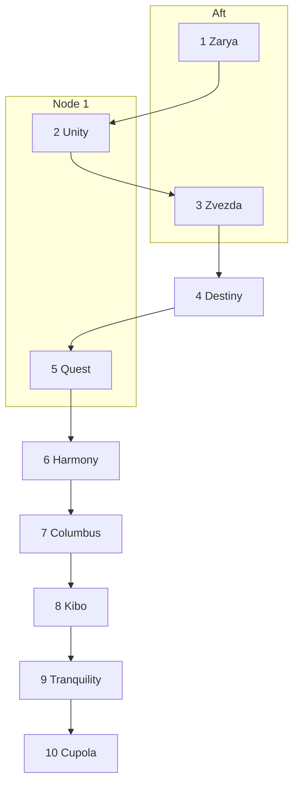

# RHEL Quest: Expedition Trainer

Participant guide for the International Space Station trainer. You are the crew. The station computer in front of you is a real Red Hat Enterprise Linux 10 system. Ten modules have to report healthy before Mission Control will clear a class 1 alarm.

Read this guide in order. Each chapter is one hatch. The same briefing is on the station computer at `/var/quest/briefing.txt` when that hatch is the one you have open. The repair itself is in the RHEL 10 documentation linked from the flight rule. This guide tells you where you are, what Capcom will accept, and how to open the next hatch.

Product documentation:

<https://docs.redhat.com/en/documentation/red_hat_enterprise_linux/10>

## Contents

1. [Arrival](#1-arrival)
2. [How a hatch works](#2-how-a-hatch-works)
3. [Rules of the run](#3-rules-of-the-run)
4. [The alarm](#4-the-alarm)
5. [The route](#5-the-route)
6. [Zarya — the time base](#6-zarya--the-time-base)
7. [Unity — the crew badge](#7-unity--the-crew-badge)
8. [Zvezda — life support](#8-zvezda--life-support)
9. [Destiny — the laboratory sample](#9-destiny--the-laboratory-sample)
10. [Quest — the airlock](#10-quest--the-airlock)
11. [Harmony — the internal bus](#11-harmony--the-internal-bus)
12. [Columbus — the payload](#12-columbus--the-payload)
13. [Kibo — the toolkit](#13-kibo--the-toolkit)
14. [Tranquility — the journal](#14-tranquility--the-journal)
15. [Cupola — the ground link](#15-cupola--the-ground-link)
16. [All clear](#16-all-clear)
17. [When a beacon stays dark](#17-when-a-beacon-stays-dark)

---

## 1. Arrival

You are in the full-task trainer, not in orbit. The mockups have the real module geometry and the real caution-and-warning tone. The computer in the trainer is UNITY-CORE. Your call sign for this run is **Expedition Trainer**.

Capcom still has a voice loop to you. That loop is the SSH session you are about to open. It is a different circuit from the station's own ground link. You can lose modules inside the station and still talk to Capcom, as long as you leave that session alone.

Your job is the one a real expedition would have if the ground lost the station's telemetry: find which function failed, restore it, and make the master alarm go quiet.

The facilitator gives you three things out of band:

- The host name or address of UNITY-CORE
- The user name
- The password

Log in, then read the banner and the briefing.

```bash
ssh <user>@<host>
cat /etc/motd
cat /var/quest/briefing.txt
cat /var/quest/ALARM
```

`/var/quest/ALARM` reads `ACTIVE` until the last beacon rewrites it. You have administrative access. `sudo` works for the account you were given.

Work as one crew. One person can hold the keyboard. The others can hold the documentation, the flight rule, and this guide. Swap when a module changes.

---

## 2. How a hatch works

Mission Control will not open the next module until the current module's beacon accepts the repair. The beacon and the keypad are trainer commands. They are not RHEL product commands. The repair underneath them is.

On each module:

1. Read the flight rule in `/var/quest/briefing.txt` and in the matching chapter of this guide.
2. Open the RHEL 10 chapter named in the flight rule and do the repair on UNITY-CORE.
3. Ask the beacon. Replace `N` with the module number:

   ```bash
   sudo iss-beacon N
   ```

4. A dark beacon prints the flight-rule line that is still false. Change the system and ask again.
5. A lit beacon prints a four-digit clearance code. Write it in the log at the end of this guide.
6. Open the next hatch with that code:

   ```bash
   sudo iss-unlock NEXT CODE
   ```

7. Read `/var/quest/briefing.txt` again. It is now the next module.

A status board shows which beacons are lit and does not print codes:

```bash
sudo iss-beacon status
```

The keypad accepts a code only after that module's beacon has actually lit. A code that was never earned on this system does not open the hatch.

Later modules can see earlier work:

- The Kibo toolkit reads the Columbus sample. Install the package whenever you reach Kibo. It reports nominal only after Columbus is mounted.
- The Cupola ground link binds only the Harmony address. Bring Harmony up before you expect that daemon to listen.
- The Cupola beacon re-checks every module. If an earlier beacon has gone dark, the alarm stays up. `sudo iss-beacon status` shows which one.

Every other beacon checks only its own module. You can take that module's code as soon as that module is healthy.

Capcom scores the live system, not the keypad. Each healthy module is worth 10 points. The alarm clears at 100. Repairing a module and then breaking it again costs those points on the next score. Lighting the beacon is how you move. The score is the state of UNITY-CORE when Capcom looks.

---

## 3. Rules of the run

These keep the trainer reachable and the exercise fair.

- Use the official RHEL 10 documentation for the repair. The flight rule is the goal. The guide is the procedure.
- Take the modules in order. Capcom's fault tree is also the walk through the station.
- Leave the SSH service you logged in with on port 22. The Cupola link is a second daemon. The product documentation for a non-default SSH port shows an example that removes port 22. That example replaces the primary daemon. This station has two.
- Leave the primary network interface and the default route alone. Harmony is a different interface.
- Leave SELinux enforcing. Destiny is a labeling problem.
- The Kibo repository is a local file on this trainer. Follow the flight rule for that repository. The DNF guide's warning about software from outside the Red Hat CDN still applies to every other system you administer.
- The beacon script and the keypad script are part of the set. Reading them is outside the exercise. Capcom scores the system, so a code copied from a script does not make a module healthy.
- Keep your current SSH session open while you test the ground link. Prove the new daemon in a second terminal.

When a beacon stays dark, use [section 17](#17-when-a-beacon-stays-dark). Capcom has further hints and will spend them if the clock requires it.

---

## 4. The alarm

At 00:17 simulator Universal Time the tone changes. The master alarm is one line, and then the panel keeps scrolling:

```text
C&W  CLASS 1  ECLSS-COMM-LOST
     TIME BASE DISAGREES WITH THE GROUND
     CREW HATCH LOCKED
     SERVICE MODULE TELEMETRY DARK
     LABORATORY SAMPLE WITHHELD
     AIRLOCK BEACON UNREACHABLE
     NODE 2 INTERNAL BUS DOWN
     COLUMBUS PAYLOAD VOLUME OFFLINE
     KIBO TOOLKIT ABSENT
     TRANQUILITY JOURNAL WILL NOT SURVIVE THE NEXT RESET
     CUPOLA GROUND LINK REFUSED
```

Capcom, on the voice loop:

> Expedition Trainer, we have a class 1 alarm, `ECLSS-COMM-LOST`. The station computer UNITY-CORE is the machine in front of you. Ten modules still have to report healthy before we can clear it. We will not open a hatch ahead of the fault tree. Each module has a beacon. When the beacon accepts the repair it prints a four-digit clearance code. That code is the keypad for the next hatch. The last beacon re-checks the whole stack. If any earlier module goes dark again, the alarm stays.

Nobody is asking you to find a single broken box. You are restoring ten functions, in the order the fault tree names them, until the ground can accept an all-clear.

---

## 5. The route

The fault tree is an inspection order, and it is a walk through the real station. You board at Zarya. You move into Unity. Capcom then sends you aft, through Zarya again, into Zvezda, because life support has to answer before anyone goes further forward. You come back through Unity and go forward into Destiny, step out to the Quest airlock, continue to Harmony, visit Columbus to port and Kibo to starboard, then return to Tranquility and climb down into the Cupola.

The detours match the station. Zvezda is aft of Zarya. Quest is on Unity. Columbus and Kibo face each other across Harmony. The Cupola looks out from the Earth-facing side of Tranquility.



| Step | Where you are | Why Capcom sends you here |
| --- | --- | --- |
| 1 | Zarya, Functional Cargo Block | First module on the boarding path. The clock is here. |
| 2 | Unity, Node 1 | The hatch into the US segment. The badge reader is the hatch. |
| 3 | Zvezda, Service Module | Aft of Zarya. Life support answers before you go forward. |
| 4 | Destiny, US Laboratory | Forward of Unity. The laboratory sample is withheld. |
| 5 | Quest airlock | Starboard of Unity. The airlock beacon is closed to the station. |
| 6 | Harmony, Node 2 | Forward of Destiny. The bus to the partner labs is down. |
| 7 | Columbus | Port side of Harmony. The payload volume is offline. |
| 8 | Kibo | Starboard side of Harmony. The toolkit is absent. |
| 9 | Tranquility, Node 3 | Port of Unity, on the way to the window. The journal will not survive a reset. |
| 10 | Cupola | Below Tranquility. The ground link is the all-clear. |

---

## 6. Zarya — the time base

You board through Zarya, the first module. The panels are awake. Every later timestamp on the caution list is useless until this clock agrees with Capcom. The Ku-band time feed is out for this run. UNITY-CORE is the reference clock for an isolated network.

### Flight briefing

```text
Module: Zarya (Functional Cargo Block)
Alarm: C&W TIME-SKEW

The station clock is not on Coordinated Universal Time, and chronyd is not
acting as the local time reference. This trainer has no usable NTP path to
the ground. Treat UNITY-CORE as the reference clock for an isolated network.

Flight rule:
- Time zone: UTC
- chronyd enabled and running
- /etc/chrony.conf provides a local reference at stratum 10
- No server, pool, or peer lines left active

When the module is healthy, run:

    sudo iss-beacon 1

The beacon prints a four-digit clearance code. Open the next hatch with:

    sudo iss-unlock 2 CODE

Guide: Configuring time synchronization, chapter "Using chrony"
(isolated network). Time zone: timedatectl in "Changing basic environment
settings".
https://docs.redhat.com/en/documentation/red_hat_enterprise_linux/10/html/configuring_time_synchronization/using-chrony
https://docs.redhat.com/en/documentation/red_hat_enterprise_linux/10/html/interactively_installing_rhel_over_the_network/changing-basic-environment-settings
```

Leave the UTC instant alone while you set the zone. A clock stepped to a made-up time can break the certificates for the rest of the session.

When beacon 1 lights, write the code in the [log](#log) and open Unity.

---

## 7. Unity — the crew badge

The hatch in front of you is Unity, Node 1, the connection into the US segment. The hatch will not take the crew badge. The account `crew` is the badge. The group `stationops` is the reader. Until that badge can run the beacon and the keypad, and only those, Capcom will not send you aft.

### Flight briefing

```text
Module: Unity (Node 1)
Alarm: HATCH-AUTH

The crew badge is not accepted. User crew must be a member of the group
stationops. That group must be allowed, through a file in /etc/sudoers.d,
to run only these commands as root, without a password:

    /usr/local/bin/iss-beacon
    /usr/local/bin/iss-unlock

A sudoers file that is writable by group or other is ignored. Granting the
group unrestricted root, or adding crew to wheel, leaves the hatch shut.

Verify with:

    sudo iss-beacon 2

Guide: Security hardening, "Managing sudo access", and sudoers(5), usermod(8).
https://docs.redhat.com/en/documentation/red_hat_enterprise_linux/10/html/security_hardening/managing-sudo-access
```

Your own admin account can already use `sudo`. Unity is asking for the crew badge on top of that, with the narrow rule in the flight briefing.

When beacon 2 lights, open Zvezda with `sudo iss-unlock 3 CODE`.

---

## 8. Zvezda — life support

Capcom sends you back through Zarya and aft into Zvezda, the service module. Oxygen, CO2, and the telemetry that tells the ground those loops are alive all sit here. The environmental unit `eclss.service` will not start. The forward labs stay closed until `/run/iss/eclss.healthy` reads `ECLSS-NOMINAL` and the service is enabled.

### Flight briefing

```text
Module: Zvezda (Service Module)
Alarm: ECLSS-TELEMETRY-DOWN

The environmental control unit eclss.service will not start. Inspect the
unit with systemctl status and systemctl cat, including drop-ins. The
service must be unmasked, enabled, and active, and /run/iss/eclss.healthy
must contain the line ECLSS-NOMINAL.

    sudo iss-beacon 3

Guide: Using systemd unit files to customize and optimize your system.
Drop-in files, masking, and enabling a service.
https://docs.redhat.com/en/documentation/red_hat_enterprise_linux/10/html-single/using_systemd_unit_files_to_customize_and_optimize_your_system/index
```

`systemctl status` and `systemctl cat` are the two views Capcom expects you to use before you change the unit. The systemd guide covers masks, drop-in files, and enabling a service at boot.

When beacon 3 lights, return forward. The next hatch is Destiny: `sudo iss-unlock 4 CODE`.

---

## 9. Destiny — the laboratory sample

You pass Unity and go forward into Destiny, the US laboratory. The experiment log is a page on UNITY-CORE. The server answers, and the page is denied. The document root is `/srv/iss/destiny`. SELinux stays enforcing. The page body contains `DESTINY-SAMPLE-OK` when the label is right.

### Flight briefing

```text
Module: Destiny (US Laboratory)
Alarm: LAB-CONTENT-DENIED

The laboratory index at http://127.0.0.1/index.html is denied. The document
root is /srv/iss/destiny. SELinux is in enforcing mode and must stay there.
The files need a permanent httpd content label. A boolean that lets httpd
read home directories is not the repair.

The page contains DESTINY-SAMPLE-OK when the repair is complete.

    sudo iss-beacon 4

Guide: Using SELinux, "Troubleshooting problems related to SELinux"
(labeling problems and non-standard directories).
https://docs.redhat.com/en/documentation/red_hat_enterprise_linux/10/html/using_selinux/troubleshooting-problems-related-to-selinux
```

The troubleshooting chapter's section on labeling problems is the one that matches a document root outside the default web tree. A permanent file-context rule is what survives a relabel. The beacon checks the live page at `http://127.0.0.1/index.html`.

When beacon 4 lights, step back toward Unity's starboard side. Quest is next: `sudo iss-unlock 5 CODE`.

---

## 10. Quest — the airlock

Quest is the airlock berthed on Unity's starboard side. The airlock beacon is already running as `iss-airlock.service`, on TCP port `8421`. firewalld is dropping that port. Loopback sits in the trusted zone, so a test against `127.0.0.1` can succeed while the rest of the station still sees a closed airlock. Capcom wants the test against this computer's own non-loopback address. The body is `AIRLOCK-NOMINAL`.

### Flight briefing

```text
Module: Quest (Airlock)
Alarm: AIRLOCK-PORT-CLOSED

The airlock beacon listens on TCP port 8421. iss-airlock.service is already
running. firewalld is dropping that port. Open 8421/tcp in the default zone
and make the change permanent. Leave the ssh service allowed.

Loopback is in the trusted zone, so a test against 127.0.0.1 does not prove
the airlock is open. Test the host's non-loopback address. The body contains
AIRLOCK-NOMINAL.

    sudo iss-beacon 5

Guide: Configuring firewalls and packet filters, "Controlling network
traffic by using firewalld". Custom ports use firewall-cmd --add-port and
firewall-cmd --runtime-to-permanent, the same persistence step as the
service procedure and the non-default SSH port procedure.
https://docs.redhat.com/en/documentation/red_hat_enterprise_linux/10/html/configuring_firewalls_and_packet_filters/using-and-configuring-firewalld
https://docs.redhat.com/en/documentation/red_hat_enterprise_linux/10/html/securing_networks/using-secure-communications-between-two-systems-with-openssh
```

Port `8421` is a custom port. Open it in the default zone and make the change survive a reload of firewalld. Leave the `ssh` service allowed. That service is your voice loop to Capcom.

When beacon 5 lights, go forward through Destiny into Harmony: `sudo iss-unlock 6 CODE`.

---

## 11. Harmony — the internal bus

Harmony is Node 2, the hub that faces the partner laboratories. Columbus is to port. Kibo is to starboard. The bus between them is the profile `harmony` on interface `iss-hnode`. It is down, and the address on that profile is wrong. This is not the interface that carries your SSH session. Leave that interface and the default route as they are.

The flight rule is `172.16.20.10/24`, manual method, no gateway and no DNS on this bus, autoconnect on, and the connection active. The Cupola ground link, three hatches from here, binds only this address. If Harmony is dark when you reach the window, the ground daemon has nowhere to listen.

### Flight briefing

```text
Module: Harmony (Node 2)
Alarm: NODE2-BUS-DOWN

The internal bus profile harmony on interface iss-hnode is down and has the
wrong address. Flight rule:

- IPv4 address 172.16.20.10/24
- method manual
- no gateway and no DNS on this bus
- connection.autoconnect yes
- connection active

Leave the primary NIC and the default route alone. Configure the existing
profile with nmcli and bring it up.

    sudo iss-beacon 6

Guide: Configuring and managing networking, "Configuring an Ethernet
connection by using nmcli" (static IPv4 and nmcli connection up). The same
ipv4.* properties apply to this profile.
https://docs.redhat.com/en/documentation/red_hat_enterprise_linux/10/html-single/configuring_and_managing_networking/index
```

The networking guide shows `nmcli connection modify` and `nmcli connection up` for a static IPv4 address. Use the profile that is already named `harmony`. An address added only for the current boot, outside NetworkManager, disappears on reboot and leaves the profile inactive. The beacon checks the profile.

When beacon 6 lights, go to port, into Columbus: `sudo iss-unlock 7 CODE`.

---

## 12. Columbus — the payload

Columbus keeps one sample from the exposure experiment. It lives in an XFS image at `/var/lib/iss/columbus.img`. The mount point `/srv/iss/columbus` is empty until that image is mounted read-write. The mount has to come back after a reboot through `/etc/fstab`. The current fstab entry is a placeholder. The file `sample.dat`, once the volume is mounted, contains the single line `COLUMBUS-PAYLOAD-OK`.

Use a loop mount of the image file. Leave the image where it is. Kibo's toolkit, the next hatch, reads this file.

### Flight briefing

```text
Module: Columbus (European laboratory)
Alarm: PAYLOAD-VOLUME-OFFLINE

The Columbus sample is an XFS image at /var/lib/iss/columbus.img. It must be
mounted on /srv/iss/columbus, read-write, and the mount must persist across
reboot through /etc/fstab. The current fstab entry is a placeholder. The
mounted file sample.dat contains the single line COLUMBUS-PAYLOAD-OK.

Use a loop mount of that image file. Leave the image file where it is.

    sudo iss-beacon 7

Guide: Managing file systems, "Persistently mounting file systems".
The loop option is described in mount(8) and fstab(5).
https://docs.redhat.com/en/documentation/red_hat_enterprise_linux/10/html/managing_file_systems/persistently-mounting-file-systems
```

The file-systems chapter is how a filesystem gets a persistent fstab line: identify it, add the line, reload the mount units, and mount the mount point. A file-backed filesystem needs the `loop` option from `mount(8)` and `fstab(5)`. A mount you make by hand, with no fstab line, fails the beacon after the next boot and fails Capcom's score now.

When beacon 7 lights, cross Harmony to starboard. Kibo is next: `sudo iss-unlock 8 CODE`.

---

## 13. Kibo — the toolkit

Kibo's exposed-facility check is the package `iss-kibo-toolkit`. The repository `iss-kibo` is already on this computer and it is disabled. The repository is unsigned and local to the trainer. Its base URL is `file:///var/lib/iss/repos/kibo`. `gpgcheck` is already off. Enable that repository and install that package. This pattern is for the trainer only.

`/usr/bin/kibo-status` prints `KIBO-NOMINAL` when the Columbus sample is mounted and readable. If the status command says it is waiting for Columbus, the previous hatch is the one to finish.

### Flight briefing

```text
Module: Kibo (Japanese Experiment Module)
Alarm: TOOLKIT-ABSENT

The local repository iss-kibo is disabled. Enable it and install the
package iss-kibo-toolkit. The repository is unsigned and local to this
trainer (baseurl file:///var/lib/iss/repos/kibo). gpgcheck is already off.
This pattern is for the trainer only.

/usr/bin/kibo-status must print KIBO-NOMINAL. It reads the Columbus sample,
so that volume has to be mounted.

    sudo iss-beacon 8

Guide: Managing software with the DNF tool, "Managing custom software
repositories".
https://docs.redhat.com/en/documentation/red_hat_enterprise_linux/10/html-single/managing_software_with_the_dnf_tool/index
```

The DNF chapter "Managing custom software repositories" is the procedure for enabling a repository and installing from it.

When beacon 8 lights, head back through Harmony and Destiny to Unity, then to port into Tranquility: `sudo iss-unlock 9 CODE`.

---

## 14. Tranquility — the journal

Tranquility is Node 3, between Unity and the Cupola. The environmental log is the systemd journal. A configuration drop-in is forcing volatile storage, so the record of this alarm would disappear on the next reset. Capcom wants the effective setting `Storage=persistent`, and journal files on disk under `/var/log/journal/` plus this machine's id, before you are allowed down into the window.

The merged configuration is what counts. A fragment can override the main file. This command shows the merge:

```bash
systemd-analyze cat-config systemd/journald.conf
```

### Flight briefing

```text
Module: Tranquility (Node 3)
Alarm: JOURNAL-VOLATILE

The station journal is not persistent. A drop-in is forcing volatile
storage. The effective configuration must set Storage=persistent.
Journal files must exist under /var/log/journal/<machine-id>.
See the merged configuration with:

    systemd-analyze cat-config systemd/journald.conf

    sudo iss-beacon 9

Guide: Automating system administration by using RHEL system roles,
"Configuring the systemd journal" (persistent logging and the
/var/log/journal verification). On this single host, set that end state
in journald configuration. See journald.conf(5), Storage=.
https://docs.redhat.com/en/documentation/red_hat_enterprise_linux/10/html/automating_system_administration_by_using_rhel_system_roles/configuring-the-systemd-journal-by-using-rhel-system-roles
```

The system-role chapter describes persistent logging and how to verify `/var/log/journal`. On this one computer, set that same end state in the journald configuration. `journald.conf(5)` documents `Storage=`. The flight rule is the value `persistent`.

When beacon 9 lights, climb down. The Cupola is the last hatch: `sudo iss-unlock 10 CODE`.

---

## 15. Cupola — the ground link

The Cupola is the window on the Earth-facing side of Tranquility. From here the ground either accepts the station or it does not. The ground link is a second OpenSSH daemon, `sshd-ground.service`, with its own file `/etc/ssh/sshd_config.ground`. Your session on port 22 stays as it is. Leave the `ssh` service in the firewall.

The daemon listens only on the Harmony address `172.16.20.10`, port `2222`, as the user `ground`, with a key. The private key is already on the station computer at `/var/quest/flight-kit/ground_ed25519`. Harmony has to be up, because that is the address the daemon binds. The host keys are the system host keys already in `/etc/ssh`.

The product procedure for a non-default SSH port includes the SELinux port type and the firewall. Add port `2222`. Leave port 22 in place. Test the new daemon from a second terminal, with the session you are using left open.

`sudo iss-beacon 10` re-checks Zarya through the Cupola. A lit beacon means every earlier module is still healthy. The final line is the all-clear.

### Flight briefing

```text
Module: Cupola
Alarm: GROUND-LINK-DOWN

The ground link is a second OpenSSH daemon, sshd-ground.service, with its
own configuration file /etc/ssh/sshd_config.ground. Leave the primary sshd
on port 22 unchanged, and leave the ssh service in the firewall.

Flight rule for the ground link:
- sshd -t -f /etc/ssh/sshd_config.ground succeeds
- ListenAddress 172.16.20.10 and Port 2222
- PasswordAuthentication no
- KbdInteractiveAuthentication no
- PermitRootLogin no
- AllowUsers ground
- PubkeyAuthentication yes
- SELinux type ssh_port_t includes tcp/2222
- firewalld allows 2222/tcp in the runtime and the permanent configuration
- sshd-ground.service is enabled and active
- A key login as ground to 172.16.20.10 port 2222 succeeds

The private key is /var/quest/flight-kit/ground_ed25519. Harmony must
already be up, because the daemon binds only that address. The host keys
are the system host keys already in /etc/ssh. Do not add a HostKey path.

    sudo iss-beacon 10

A lit beacon means every earlier module is still healthy. The final line
is the all-clear.

Guide: Securing networks, "Using secure communications between two systems
with OpenSSH".
- Setting key-based authentication as the only method
- Setting a non-default port for SSH (semanage port and firewalld)
- SSH access only for specific users
https://docs.redhat.com/en/documentation/red_hat_enterprise_linux/10/html/securing_networks/using-secure-communications-between-two-systems-with-openssh
```

Start with the configuration test the flight rule names:

```bash
sudo sshd -t -f /etc/ssh/sshd_config.ground
```

Then bring the service up, prove a key login as `ground`, and run beacon 10. If an earlier module has gone dark, the beacon names it. Fix that module and ask again. There is no hatch 11.

---

## 16. All clear

A lit Cupola beacon prints three things: the words `ALARM CLEARED`, a final clearance code, and a mission code made of all ten codes in order. `/var/quest/ALARM` reads `CLEARED`.

```bash
cat /var/quest/ALARM
```

Read the mission code to Capcom. Capcom scores UNITY-CORE from outside the trainer. One hundred points clears the class 1 alarm. If a module was healthy when you passed it and is dark again now, the score follows the system, and beacon 10 will have told you which one.

The tone stops when the ground link accepts `ground` with a key and every module beacon is still lit. That is the end of the run.

---

## 17. When a beacon stays dark

The beacon's sentence is the flight rule that is still false. Use it in this order.

1. Read the sentence from `sudo iss-beacon N` next to the flight briefing in this chapter.
2. Open the RHEL 10 page linked from that briefing. Stay in the chapter the briefing names.
3. Check the health mark for this module, where the briefing gives you one:

   | Module | What healthy looks like |
   | --- | --- |
   | Zvezda | The line `ECLSS-NOMINAL` in `/run/iss/eclss.healthy` |
   | Destiny | `DESTINY-SAMPLE-OK` from `http://127.0.0.1/index.html` |
   | Quest | `AIRLOCK-NOMINAL` from TCP `8421` on a non-loopback address |
   | Columbus | The single line `COLUMBUS-PAYLOAD-OK` in the mounted `sample.dat` |
   | Kibo | The line `KIBO-NOMINAL` from `/usr/bin/kibo-status` |

4. Run `sudo iss-beacon status` if a later beacon complains about an earlier module.
5. Ask Capcom if the beacon has been dark longer than the crew can usefully spend. Capcom has a hint ladder and will give the next hint, not the whole repair.

Useful checks that match the flight rules, without replacing the documentation:

```bash
timedatectl
chronyc tracking
id crew
sudo -l -U crew
systemctl status eclss.service
systemctl cat eclss.service
curl -fsS http://127.0.0.1/index.html
firewall-cmd --query-port=8421/tcp
firewall-cmd --permanent --query-port=8421/tcp
nmcli connection show harmony
findmnt /srv/iss/columbus
kibo-status
systemd-analyze cat-config systemd/journald.conf
sudo sshd -t -f /etc/ssh/sshd_config.ground
systemctl status sshd-ground.service
```

Run only the checks for the module you are in. A green check on loopback is not a green airlock. A package that is installed is not a Kibo beacon until `kibo-status` prints `KIBO-NOMINAL`.

---

## Log

Write each clearance code when the beacon prints it. The keypad command is `sudo iss-unlock NEXT CODE`.

| Hatch | Module | Clearance code | Next hatch |
| --- | --- | --- | --- |
| 1 | Zarya | | `sudo iss-unlock 2 CODE` |
| 2 | Unity | | `sudo iss-unlock 3 CODE` |
| 3 | Zvezda | | `sudo iss-unlock 4 CODE` |
| 4 | Destiny | | `sudo iss-unlock 5 CODE` |
| 5 | Quest | | `sudo iss-unlock 6 CODE` |
| 6 | Harmony | | `sudo iss-unlock 7 CODE` |
| 7 | Columbus | | `sudo iss-unlock 8 CODE` |
| 8 | Kibo | | `sudo iss-unlock 9 CODE` |
| 9 | Tranquility | | `sudo iss-unlock 10 CODE` |
| 10 | Cupola | | All clear. Read the mission code to Capcom. |

Mission code, from beacon 10:

```text
____-____-____-____-____-____-____-____-____-____
```
