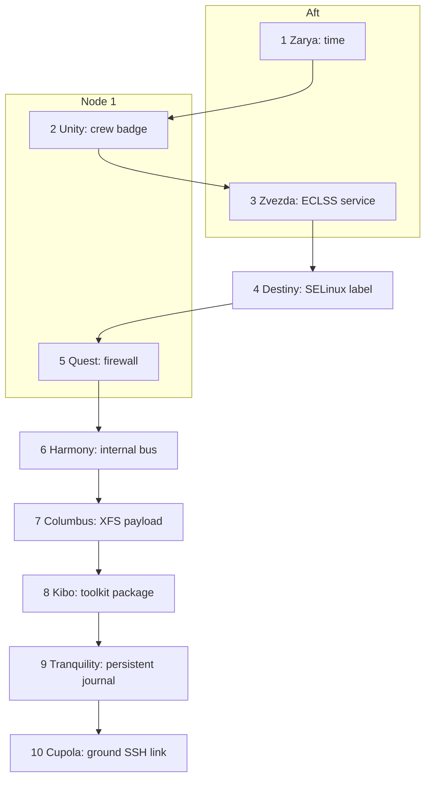

# RHEL Quest: Caution and Warning on the ISS

Facilitator guide for a ten-stage Red Hat Enterprise Linux 10 exercise. The team plays an expedition in a full-task trainer of the International Space Station. The station computer is a real RHEL 10 virtual machine. Each stage is a real fault on that system. The repair is a procedure from the official RHEL 10 product documentation.

This file contains every clearance code, the broken state, and both Ansible playbooks. It is the game-master copy. Players receive only the briefing that the setup playbook installs on the VM (`/var/quest/briefing.txt`). Give them SSH access out of band. Do not give them this file.

Run the setup playbook only on a disposable quest VM. It changes timekeeping, sudo rules, firewalld, a systemd unit, SELinux labels, a NetworkManager profile, fstab, a DNF repository, journald, and a second OpenSSH daemon. It leaves the primary SSH daemon on port 22 and the primary network path in place so you can still reach the VM.

Documentation home:

<https://docs.redhat.com/en/documentation/red_hat_enterprise_linux/10>

## Contents

1. [How the exercise works](#1-how-the-exercise-works)
2. [Frame story](#2-frame-story)
3. [The route through the station](#3-the-route-through-the-station)
4. [Clearance codes and scoring](#4-clearance-codes-and-scoring)
5. [The ten riddles](#5-the-ten-riddles)
6. [Debrief when the alarm clears](#6-debrief-when-the-alarm-clears)
7. [Facilitator runbook](#7-facilitator-runbook)
8. [Setup playbook](#8-setup-playbook)
9. [Score playbook](#9-score-playbook)
10. [Inventory and extraction](#10-inventory-and-extraction)

---

## 1. How the exercise works

The team logs in to one RHEL 10 system. In the story the system is the station computer **UNITY-CORE**. An alarm is already sounding when they arrive. Mission Control will not open the next module until the current module's beacon prints a four-digit clearance code.

They work in order:

1. Read `/var/quest/briefing.txt`.
2. Repair the fault described there, using the RHEL 10 documentation named in the briefing.
3. Run `sudo iss-beacon N`.
4. If the repair matches the flight rule, the beacon prints a clearance code and records that the beacon is lit.
5. Run `sudo iss-unlock NEXT CODE` to replace the briefing with the next module.

The tools `iss-beacon` and `iss-unlock` are part of the trainer. They are not product commands. Everything they check is repaired with product commands (`timedatectl`, `chronyc`, `usermod`, `visudo`, `systemctl`, `semanage`, `restorecon`, `firewall-cmd`, `nmcli`, `mount`, `dnf`, `journalctl`, `sshd`).

The score playbook does not trust those tools. It inspects the live system a second time, from your control node, with its own copy of the pass conditions. Reading the beacon script, writing the word `CLEARED` into a status file, or unlocking a hatch by hand does not add points.

Two later repairs depend on earlier ones:

- `kibo-status` (Kibo, riddle 8) reads the Columbus payload file. The package can be installed before the volume is mounted, and it will exit non-zero until Columbus is mounted.
- The Cupola SSH daemon (riddle 10) binds only `172.16.20.10`. That address appears when the Harmony profile is up (riddle 6).
- The Cupola beacon re-checks all ten modules before it prints the final code. A regression earlier in the station keeps the alarm active.

Each other beacon checks only its own module, so the team can collect that module's code as soon as that module is healthy.

### What the team is told out of band

Tell them:

- The SSH target, the user (`questadmin` unless you changed it), and the lab password.
- They have full administrative access and may use `sudo`.
- The exercise rules: use the product documentation, work in order, leave the primary SSH service on port 22 alone, and leave the primary NIC and default route alone.
- Reading `/usr/local/bin/iss-beacon`, `/usr/local/bin/iss-unlock`, or this guide is outside the exercise.

### Pass words the beacons look for

These strings are module health marks, not the clearance codes:

| Module | Mark |
| --- | --- |
| Zvezda | `ECLSS-NOMINAL` in `/run/iss/eclss.healthy` |
| Destiny | `DESTINY-SAMPLE-OK` in the lab page |
| Quest | `AIRLOCK-NOMINAL` from TCP `8421` on a non-loopback address |
| Columbus | `COLUMBUS-PAYLOAD-OK` as the only line of `sample.dat` |
| Kibo | `KIBO-NOMINAL` from `/usr/bin/kibo-status` |

---

## 2. Frame story

The session starts in the full-task trainer, not in orbit. The mockups have the real module geometry, the real caution-and-warning tones, and a station computer that is a real Red Hat Enterprise Linux 10 system. The crew's call sign for the run is Expedition Trainer. Their job is the one a real expedition would have if Mission Control lost the station's own telemetry: find which function failed, restore it, and make the master alarm go quiet.

At 00:17 simulator Universal Time the tone changes. The master alarm is not a single red lamp. The caution-and-warning panel scrolls one line and then keeps scrolling:

```text
C&W  CLASS 1  ECLSS-COMM-LOST
     TIME BASE DISAGREES WITH THE GROUND
     CREW HATCH LOCKED
     SERVICE MODULE TELEMETRY DARK
     LABORATORY SAMPLE WITHHELD
     AIRLOCK BEACON UNREACHABLE
     NODE 2 INTERNAL BUS DOWN
     COLUMBUS PAYLOAD VOLUME OFFLINE
     KIBO TOOLKIT ABSENT
     TRANQUILITY JOURNAL WILL NOT SURVIVE THE NEXT RESET
     CUPOLA GROUND LINK REFUSED
```

Mission Control's voice loop is still up, because the trainer's own SSH path is a different circuit from the station's ground link. Capcom gives the rules and then stops helping:

> Expedition Trainer, we have a class 1 alarm, `ECLSS-COMM-LOST`. The station computer UNITY-CORE is the machine in front of you. Ten modules still have to report healthy before we can clear it. We will not open a hatch ahead of the fault tree. Each module has a beacon. When the beacon accepts the repair it prints a four-digit clearance code. That code is the keypad for the next hatch. The last beacon re-checks the whole stack. If any earlier module goes dark again, the alarm stays.

The fault tree is an inspection order, and it is also a walk through the real station. The team boards at Zarya, the first module. They move into Unity. They are then sent aft, through Zarya again, into Zvezda, because life support has to answer before anyone is allowed further forward. They come back through Unity and go forward into Destiny, step out to the Quest airlock, continue to Harmony, visit Columbus to port and Kibo to starboard, then return all the way to Tranquility and climb down into the Cupola. The detours are deliberate. Zvezda really is aft of Zarya. Quest really is on Unity. Columbus and Kibo really face each other across Harmony. The Cupola really looks out from the Earth-facing side of Tranquility.

What the team does not know until the debrief is that nobody sabotaged the station. A maintenance window on the trainer was left half finished. The clock was moved to a test time zone. A sudo rule was saved with unsafe permissions, so sudo ignores it. The life-support unit was masked behind a drop-in that points at a program that is not there. Laboratory files were moved onto the document root with `mv`, so they kept a home-directory SELinux label. The airlock port was never added to the firewall. Harmony's internal bus was left down on the wrong address. The Columbus sample still sits in an XFS image with a placeholder line in `/etc/fstab`. The Kibo repository was disabled before the toolkit was installed. Journald was pinned to volatile storage by a drop-in, so the alarm record would vanish on reboot. The Cupola ground link, a second `sshd`, was left with an empty `AllowUsers` line and with password login still on.

None of those faults is a failed computer. Together they are why the environmental telemetry cannot be shown to the ground, and why the ground cannot accept the all-clear. The team restores the functions in the order Capcom gives them. When the Cupola link accepts a key from the user `ground`, and every earlier beacon is still lit, UNITY-CORE drops the class 1 alarm.

The props on the machine are:

- `/var/quest/briefing.txt` is the hatch they currently have open.
- `/var/quest/ALARM` reads `ACTIVE` until the final beacon rewrites it.
- `/etc/motd` is the alarm banner they see at login.
- `sudo iss-beacon N` is the module beacon.
- `sudo iss-unlock NEXT CODE` is the keypad.

---

## 3. The route through the station



| Step | Where they are | Why the story sends them here | RHEL area |
| --- | --- | --- | --- |
| 1 | Zarya, Functional Cargo Block | First module on the boarding path. The legacy clock lives here. | Time zone and chrony as an isolated reference |
| 2 | Unity, Node 1 | The hatch into the US segment. The badge reader is the hatch. | Users, groups, and sudo |
| 3 | Zvezda, Service Module | Aft of Zarya. Life support must answer before the team goes forward. | systemd unit, mask, and drop-in |
| 4 | Destiny, US Laboratory | Forward of Unity. The sample web page is withheld. | SELinux file labels for `httpd` |
| 5 | Quest airlock | Starboard of Unity. The airlock beacon is filtered. | firewalld, persistent open port |
| 6 | Harmony, Node 2 | Forward of Destiny. The internal bus to the partner labs is down. | NetworkManager static IPv4 |
| 7 | Columbus | Port side of Harmony. The payload volume is not mounted. | Persistent XFS loop mount |
| 8 | Kibo | Starboard side of Harmony. The toolkit was never installed. | DNF custom repository |
| 9 | Tranquility, Node 3 | Port of Unity, on the way to the window. The journal will not survive a reboot. | Persistent systemd journal |
| 10 | Cupola | Nadir of Tranquility. The ground link is the all-clear. | OpenSSH key-only access on a non-default port |

Physical walk, in sentences the facilitator can read aloud:

1. The team boards through Zarya and repairs the clock before they trust any other timestamp.
2. They open the hatch into Unity and make the crew badge work.
3. Capcom sends them aft through Zarya into Zvezda. The service module's life-support process has to be running before the forward labs will accept a sample.
4. They return to Unity and go forward into Destiny. The laboratory page is on the station computer, and the policy will not let the web server read it.
5. They step back to Quest, on Unity's starboard side, and open the airlock telemetry port.
6. They go forward again, through Destiny, into Harmony, and bring up the internal bus.
7. From Harmony they go to port, into Columbus, and mount the payload image.
8. They cross Harmony to Kibo and install the toolkit that reads the Columbus sample.
9. They travel back to Unity and then to port, into Tranquility, and make the journal persistent so the alarm record survives.
10. They descend into the Cupola. The ground link comes up on the Harmony address. Capcom acknowledges. The tone stops.

---

## 4. Clearance codes and scoring

The beacon prints a code only after that module's pass conditions are true. Riddle 10 prints its code only after all ten are true.

| Riddle | Module | Code | Unlocks |
| --- | --- | --- | --- |
| 1 | Zarya | `4821` | Briefing 2 |
| 2 | Unity | `7036` | Briefing 3 |
| 3 | Zvezda | `9154` | Briefing 4 |
| 4 | Destiny | `2267` | Briefing 5 |
| 5 | Quest | `3380` | Briefing 6 |
| 6 | Harmony | `4519` | Briefing 7 |
| 7 | Columbus | `5642` | Briefing 8 |
| 8 | Kibo | `6775` | Briefing 9 |
| 9 | Tranquility | `7808` | Briefing 10 |
| 10 | Cupola | `8941` | The all-clear. There is no briefing 11. |

Mission code, spoken by Capcom only when the score is 100:

```text
4821-7036-9154-2267-3380-4519-5642-6775-7808-8941
```

### Points

| Result | Points |
| --- | --- |
| Each riddle whose live system matches the pass conditions | 10 |
| Maximum | 100 |
| Alarm | `CLEARED` only at 100. Any lower score leaves it `ACTIVE`. |

Unlocking a hatch is how the team sees the next story. It is not worth points. A riddle scores when the system is actually repaired, even if the team has not yet typed the code. If they repair module 6 and later break it, the next score run takes those 10 points away.

The Cupola beacon is stricter than the scoreboard on purpose. The scoreboard shows which module is dark. The final beacon stays silent until the whole stack is lit, because that is the alarm logic in the story.

### Commands the team uses

```bash
sudo iss-beacon status          # lit or dark, no codes
sudo iss-beacon 1               # code, or the flight-rule line that is still false
sudo iss-unlock 2 4821          # example only, after beacon 1 is really lit
cat /var/quest/briefing.txt
cat /var/quest/ALARM
```

`iss-unlock` accepts a code only if the previous beacon has already recorded a successful check. Knowing the number without lighting the beacon does not open the hatch.

---

## 5. The ten riddles

Each riddle below has the story beat, the briefing the VM shows the team, the fault the setup playbook plants, the best repair, the documentation, the pass conditions, and a hint ladder. Hint 1 is already in the briefing. Use hint 2 when they have been stuck for a while. Use hint 3 when the session clock requires it. The commands in "Best repair" are the answer key.

### Riddle 1 — Zarya: the time base

**Story.** Zarya's panels are awake and the rest of the caution list is a blur of timestamps that cannot be compared with Capcom's clock. The local time is fourteen hours ahead of Universal Time. `chronyd` is stopped, and the configuration still names a documentation address on TEST-NET that will never answer. Capcom tells them the Ku-band time feed is out for this run. UNITY-CORE has to be the reference clock for an isolated network, at stratum 10, on UTC.

**Player briefing** (installed as `/var/quest/sealed/01-zarya.txt` and as the initial `/var/quest/briefing.txt`):

```text
Module: Zarya (Functional Cargo Block)
Alarm: C&W TIME-SKEW

The station clock is not on Coordinated Universal Time, and chronyd is not
acting as the local time reference. This trainer has no usable NTP path to
the ground. Treat UNITY-CORE as the reference clock for an isolated network.

Flight rule:
- Time zone: UTC
- chronyd enabled and running
- /etc/chrony.conf provides a local reference at stratum 10
- No server, pool, or peer lines left active

When the module is healthy, run:

    sudo iss-beacon 1

The beacon prints a four-digit clearance code. Open the next hatch with:

    sudo iss-unlock 2 CODE

Guide: Configuring time synchronization, chapter "Using chrony"
(isolated network). Time zone: timedatectl in "Changing basic environment
settings".
https://docs.redhat.com/en/documentation/red_hat_enterprise_linux/10/html/configuring_time_synchronization/using-chrony
https://docs.redhat.com/en/documentation/red_hat_enterprise_linux/10/html/interactively_installing_rhel_over_the_network/changing-basic-environment-settings
```

**What is broken.**

- Time zone is `Pacific/Kiritimati` (UTC+14). The UTC instant is unchanged, so TLS and your SSH session keep working. The displayed local time is wrong.
- `chronyd` is stopped and disabled. `timedatectl set-ntp false` has been applied.
- `/etc/chrony.conf` contains `server 198.51.100.10 iburst` and has no `local stratum` directive. `198.51.100.0/24` is TEST-NET-2, reserved for documentation.

**Symptoms.** `timedatectl` shows the Pacific zone and an inactive NTP service. `systemctl status chronyd` shows inactive. `chronyc tracking` cannot talk to a running daemon.

**Best repair.**

1. Set the zone. Leave the UTC instant alone. Stepping the clock to a made-up time can invalidate certificates for the rest of the lab.

   ```bash
   sudo timedatectl set-timezone UTC
   ```

2. Replace the network sources with a local reference. This follows "Configuring chrony in an isolated network": one computer is the primary time server and uses the `local` directive. This VM is that computer. Stratum 10 is the flight rule (the guide's example uses stratum 8 on a server that has clients; the directive is the same).

   `/etc/chrony.conf`:

   ```text
   driftfile /var/lib/chrony/drift
   makestep 1.0 3
   rtcsync
   logdir /var/log/chrony
   local stratum 10
   manual
   ```

   Delete or comment every `server`, `pool`, and `peer` line. If a public pool remains, chronyd will prefer it and the stratum will not be 10.

3. Enable and start the daemon, then confirm the stratum:

   ```bash
   sudo systemctl enable --now chronyd
   sudo chronyc makestep
   chronyc tracking
   timedatectl
   ```

   `chronyc tracking` shows `Stratum : 10` and a normal leap status. `timedatectl` shows `Time zone: UTC` and an active NTP service.

`allow` is for serving other computers. This trainer has no other NTP clients, so it is optional and the beacon does not require it.

**Why this is the repair to teach.** `timedatectl set-ntp true` only enables the vendor daemon. It leaves the dead `server` line in place. The isolated-network chapter is the one that matches a station with no path to public NTP.

**Pass conditions.** Time zone `UTC`. `chronyd` active and enabled. An uncommented `local stratum 10` in `/etc/chrony.conf`. No uncommented `server`, `pool`, or `peer` line. `chronyc tracking` reports stratum 10.

**Code.** `4821`. Next hatch: `sudo iss-unlock 2 4821`.

**Hints.**

1. The briefing names the guide and the flight rule.
2. `timedatectl` shows the zone. `systemctl status chronyd` shows whether the daemon is running. The dead source is a `server` line in `/etc/chrony.conf`.
3. `timedatectl set-timezone UTC`, then `local stratum 10` and `manual`, then `systemctl enable --now chronyd`.

### Riddle 2 — Unity: the crew badge

**Story.** The Unity hatch into the US segment does not take the crew badge. The account `crew` exists and has a password, and the group `stationops` exists, but `crew` is not in that group. A sudo rule in `/etc/sudoers.d/crew` looks generous and is useless: the file is writable by others, so sudo ignores it. The ignored rule would also have been the wrong rule. Unity wants a badge that can run only the beacon and the keypad.

**Player briefing:**

```text
Module: Unity (Node 1)
Alarm: HATCH-AUTH

The crew badge is not accepted. User crew must be a member of the group
stationops. That group must be allowed, through a file in /etc/sudoers.d,
to run only these commands as root, without a password:

    /usr/local/bin/iss-beacon
    /usr/local/bin/iss-unlock

A sudoers file that is writable by group or other is ignored. Granting the
group unrestricted root, or adding crew to wheel, leaves the hatch shut.

Verify with:

    sudo iss-beacon 2

Guide: Security hardening, "Managing sudo access", and sudoers(5), usermod(8).
https://docs.redhat.com/en/documentation/red_hat_enterprise_linux/10/html/security_hardening/managing-sudo-access
```

**What is broken.**

- Group `stationops` exists. User `crew` is not a member.
- `/etc/sudoers.d/crew` is mode `0666` and contains `crew ALL=(ALL) ALL`. sudo skips a sudoers file that is writable by group or other. The main `/etc/sudoers` and the `wheel` rule for `questadmin` still work, which is why the team can repair this.
- There is no `%stationops` rule for the two trainer commands.

**Symptoms.** `id crew` does not list `stationops`. `sudo -l -U crew` does not list the beacon. `ls -l /etc/sudoers.d/crew` shows the unsafe mode. The journal may contain a sudo warning about the file mode.

**Best repair.**

1. Put the crew account in the badge group. `-a` keeps existing supplementary groups.

   ```bash
   sudo usermod -aG stationops crew
   id crew
   ```

2. Remove the ignored file. `chmod 0440` on that file would make `crew ALL=(ALL) ALL` active, and the beacon rejects an unrestricted rule.

   ```bash
   sudo rm -f /etc/sudoers.d/crew
   ```

3. Add a least-privilege rule with `visudo`, as the sudo chapter recommends for files under `/etc/sudoers.d/`. The chapter's rule format is `user host=(run_as) command`. A name that starts with `%` is a group. `NOPASSWD` is the sudoers tag that matches the flight rule "without a password".

   ```bash
   sudo visudo -f /etc/sudoers.d/stationops
   ```

   File contents:

   ```text
   %stationops ALL=(root) NOPASSWD: /usr/local/bin/iss-beacon, /usr/local/bin/iss-unlock
   ```

4. The file must be owned by `root:root` and mode `0440` (or `0400`). `visudo` does this when it installs the file. Confirm:

   ```bash
   sudo visudo -c
   sudo ls -l /etc/sudoers.d/stationops
   sudo -l -U crew
   ```

**Pass conditions.** `crew` is a member of `stationops`. `sudo -l -U crew` lists both commands, lists `NOPASSWD`, and does not list `ALL` as a command. Every file in `/etc/sudoers.d` is owned by `root:root` and is not writable by group or other. Some file in that directory has a `%stationops` rule for each of the two commands. `visudo -c` succeeds.

**Code.** `7036`. Next hatch: `sudo iss-unlock 3 7036`.

**Hints.**

1. The briefing names the two commands, the group, and the directory.
2. `ls -l /etc/sudoers.d` shows a file sudo will not read. `id crew` shows the missing group.
3. `usermod -aG stationops crew`, remove the unsafe file, and install the one-line `%stationops` rule with `visudo -f`.

### Riddle 3 — Zvezda: life-support telemetry

**Story.** Capcom sends the team aft. Zvezda is the service module: oxygen, CO2, and the telemetry process that tells the ground those loops are alive. The unit `eclss.service` is masked, so it cannot be started. Under the mask, a drop-in clears `ExecStart` and points it at `/usr/local/libexec/eclss-missing`, which was never installed. The real program is already on disk.

**Player briefing:**

```text
Module: Zvezda (Service Module)
Alarm: ECLSS-TELEMETRY-DOWN

The environmental control unit eclss.service will not start. Inspect the
unit with systemctl status and systemctl cat, including drop-ins. The
service must be unmasked, enabled, and active, and /run/iss/eclss.healthy
must contain the line ECLSS-NOMINAL.

    sudo iss-beacon 3

Guide: Using systemd unit files to customize and optimize your system.
Drop-in files, masking, and enabling a service.
https://docs.redhat.com/en/documentation/red_hat_enterprise_linux/10/html-single/using_systemd_unit_files_to_customize_and_optimize_your_system/index
```

**What is broken.**

- `/etc/systemd/system/eclss.service` is a normal simple service. Its `ExecStart` is `/usr/local/libexec/eclss-sim`, which writes `ECLSS-NOMINAL` and then waits.
- `/etc/systemd/system/eclss.service.d/override.conf` contains:

  ```ini
  [Service]
  ExecStart=
  ExecStart=/usr/local/libexec/eclss-missing
  ```

  An empty `ExecStart=` clears the command from the main unit. The next line replaces it.
- The unit is masked. A mask is a symlink to `/dev/null`. `systemctl start` cannot override it. The unit is also disabled.

**Symptoms.** `systemctl status eclss.service` says `masked`. `systemctl cat eclss.service` shows the drop-in and the missing program. `ls -l /etc/systemd/system/eclss.service` shows the symlink to `/dev/null` while the mask is in place (`systemctl cat` still shows the vendor-style unit and the drop-in from the files on disk).

**Best repair.**

1. Unmask before enable. The systemd guide says to check for a mask and unmask before enabling.

   ```bash
   systemctl status eclss.service
   sudo systemctl unmask eclss.service
   ```

2. Remove the drop-in and reload. Deleting the drop-in restores the `ExecStart` from the unit file. Editing the drop-in so it no longer mentions `eclss-missing` is also valid.

   ```bash
   sudo rm -rf /etc/systemd/system/eclss.service.d
   sudo systemctl daemon-reload
   systemctl cat eclss.service
   ```

3. Enable and start, then read the health file:

   ```bash
   sudo systemctl enable --now eclss.service
   systemctl is-active eclss.service
   cat /run/iss/eclss.healthy
   ```

**Pass conditions.** `systemctl is-enabled eclss.service` prints `enabled`. The service is active. `/run/iss/eclss.healthy` is exactly `ECLSS-NOMINAL`. `systemctl cat eclss.service` does not contain `eclss-missing`.

**Code.** `9154`. Next hatch: `sudo iss-unlock 4 9154`.

**Hints.**

1. The briefing names `systemctl status` and `systemctl cat`.
2. The status line says `masked`. The cat output shows a second `ExecStart` under a drop-in directory.
3. `systemctl unmask eclss.service`, remove `/etc/systemd/system/eclss.service.d`, `daemon-reload`, then `systemctl enable --now eclss.service`.

### Riddle 4 — Destiny: the laboratory sample

**Story.** Destiny's experiment log is a web page on UNITY-CORE. The server is running. The page answers `403`. The files live in `/srv/iss/destiny` because a maintainer moved them out of a home directory with `mv`. Move keeps the SELinux label. The label is `user_home_t`. The policy allows `httpd` to read `httpd_sys_content_t`, which is the case the SELinux troubleshooting chapter uses for a non-standard document root such as `/srv/myweb`.

**Player briefing:**

```text
Module: Destiny (US Laboratory)
Alarm: LAB-CONTENT-DENIED

The laboratory index at http://127.0.0.1/index.html is denied. The document
root is /srv/iss/destiny. SELinux is in enforcing mode and must stay there.
The files need a permanent httpd content label. A boolean that lets httpd
read home directories is not the repair.

The page contains DESTINY-SAMPLE-OK when the repair is complete.

    sudo iss-beacon 4

Guide: Using SELinux, "Troubleshooting problems related to SELinux"
(labeling problems and non-standard directories).
https://docs.redhat.com/en/documentation/red_hat_enterprise_linux/10/html/using_selinux/troubleshooting-problems-related-to-selinux
```

**What is broken.**

- `httpd` is enabled and running. `/etc/httpd/conf.d/destiny.conf` sets `DocumentRoot "/srv/iss/destiny"` and grants access in `<Directory>`.
- `/srv/iss/destiny/index.html` is labeled `user_home_t`.
- There is no permanent file-context rule for that tree.
- The boolean `httpd_read_user_content` is off. Turning it on would hide the mistake and is rejected by the flight rule in the briefing. The beacon's pass condition is the label itself, so the boolean is not sufficient.

**Symptoms.** `curl -sI http://127.0.0.1/index.html` returns `403`. `ausearch -m AVC -ts recent` or `journalctl -t setroubleshoot` names `httpd` and `user_home_t`. `ls -Z /srv/iss/destiny` shows the home label. `getenforce` prints `Enforcing`.

**Best repair.** The troubleshooting chapter's procedure for a non-standard directory:

```bash
sudo semanage fcontext -a -t httpd_sys_content_t '/srv/iss/destiny(/.*)?'
sudo restorecon -R -v /srv/iss/destiny
sudo systemctl restart httpd
curl -fsS http://127.0.0.1/index.html
ls -Z /srv/iss/destiny/index.html
```

`semanage fcontext` records the label. `restorecon` applies it. A bare `chcon` would pass until the next relabel, and the score requires the permanent rule as well as the live label.

If `semanage fcontext -a` says the rule exists, use `-m` to modify it instead of adding a second one.

**Pass conditions.** `getenforce` is `Enforcing`. The live context of `/srv/iss/destiny/index.html` contains `httpd_sys_content_t`. `semanage fcontext -l` contains `/srv/iss/destiny` and `httpd_sys_content_t`. `httpd` is active. `curl` of `http://127.0.0.1/index.html` contains `DESTINY-SAMPLE-OK`.

**Code.** `2267`. Next hatch: `sudo iss-unlock 5 2267`.

**Hints.**

1. The briefing names the path, the denial, and the SELinux troubleshooting chapter.
2. `ls -Z` on the document root shows `user_home_t`. `ausearch -m AVC -ts recent` names `httpd`.
3. `semanage fcontext -a -t httpd_sys_content_t '/srv/iss/destiny(/.*)?'` and `restorecon -R -v /srv/iss/destiny`.

### Riddle 5 — Quest: the airlock port

**Story.** Quest is the airlock on Unity's starboard berthing port. The airlock beacon is a small service, `iss-airlock.service`, already listening on TCP `8421`. firewalld's default zone does not allow that port. From the station, loopback sits in the `trusted` zone, so a test against `127.0.0.1` succeeds even while the airlock is closed to every other interface. Capcom wants the test done against the computer's own non-loopback address.

**Player briefing:**

```text
Module: Quest (Airlock)
Alarm: AIRLOCK-PORT-CLOSED

The airlock beacon listens on TCP port 8421. iss-airlock.service is already
running. firewalld is dropping that port. Open 8421/tcp in the default zone
and make the change permanent. Leave the ssh service allowed.

Loopback is in the trusted zone, so a test against 127.0.0.1 does not prove
the airlock is open. Test the host's non-loopback address. The body contains
AIRLOCK-NOMINAL.

    sudo iss-beacon 5

Guide: Configuring firewalls and packet filters, "Controlling network
traffic by using firewalld". Custom ports use firewall-cmd --add-port and
firewall-cmd --runtime-to-permanent, the same persistence step as the
service procedure and the non-default SSH port procedure.
https://docs.redhat.com/en/documentation/red_hat_enterprise_linux/10/html/configuring_firewalls_and_packet_filters/using-and-configuring-firewalld
https://docs.redhat.com/en/documentation/red_hat_enterprise_linux/10/html/securing_networks/using-secure-communications-between-two-systems-with-openssh
```

**What is broken.** `iss-airlock.service` is enabled and running (`python3 -m http.server 8421` bound to `0.0.0.0`, document root `/srv/iss/quest`). The default zone has no `8421/tcp` rule. The `ssh` service is allowed and must remain allowed.

**Symptoms.** `ss -tulpn | grep 8421` shows the listener. `firewall-cmd --query-port=8421/tcp` prints `no`. `curl` to `127.0.0.1:8421` works. `curl` to the host's other IPv4 address times out or is rejected.

**Best repair.** Port `8421` is not a predefined firewalld service, so this is a custom port. The firewall guide's CLI procedure adds the traffic and then makes it permanent with `--runtime-to-permanent`. The OpenSSH chapter shows the same persistence for a custom port via `--add-port`.

```bash
sudo firewall-cmd --add-port=8421/tcp
sudo firewall-cmd --runtime-to-permanent
sudo firewall-cmd --query-port=8421/tcp
sudo firewall-cmd --permanent --query-port=8421/tcp
ip -4 route get 1.1.1.1
curl -fsS "http://<that-src-address>:8421/"
```

`--permanent --add-port=8421/tcp` followed by `firewall-cmd --reload` is the same end state. Both runtime and permanent configuration must contain the port. Reloading or restarting firewalld must not close it.

Leave `ssh` in the zone. Moving the primary interface into the `trusted` zone would also make the curl succeed, and it would drop the firewall as a control. The score requires the specific port in the default zone, queried without a zone override, which is the default zone.

**Pass conditions.** `firewall-cmd --query-port=8421/tcp` succeeds. The same query with `--permanent` succeeds. `iss-airlock.service` is active. An HTTP GET of port `8421` on a non-loopback IPv4 address of this host returns `AIRLOCK-NOMINAL`.

**Code.** `3380`. Next hatch: `sudo iss-unlock 6 3380`.

**Hints.**

1. The briefing names the port, firewalld, and the loopback trap.
2. `firewall-cmd --list-all` shows services and ports for the default zone. `ssh` should still be in that list.
3. `firewall-cmd --add-port=8421/tcp` and `firewall-cmd --runtime-to-permanent`.

### Riddle 6 — Harmony: the internal bus

**Story.** Harmony is Node 2, the hub that faces Columbus and Kibo. Between those modules the trainer uses an internal bus, not the NIC that carries the team's SSH session. The bus is a dummy interface, `iss-hnode`, with a NetworkManager profile named `harmony`. It is down. The profile address is `172.16.20.100/24`. The flight rule says `172.16.20.10/24`, no gateway, and the profile must come back by itself after a reboot.

**Player briefing:**

```text
Module: Harmony (Node 2)
Alarm: NODE2-BUS-DOWN

The internal bus profile harmony on interface iss-hnode is down and has the
wrong address. Flight rule:

- IPv4 address 172.16.20.10/24
- method manual
- no gateway and no DNS on this bus
- connection.autoconnect yes
- connection active

Leave the primary NIC and the default route alone. Configure the existing
profile with nmcli and bring it up.

    sudo iss-beacon 6

Guide: Configuring and managing networking, "Configuring an Ethernet
connection by using nmcli" (static IPv4 and nmcli connection up). The same
ipv4.* properties apply to this profile.
https://docs.redhat.com/en/documentation/red_hat_enterprise_linux/10/html-single/configuring_and_managing_networking/index
```

**What is broken.** Profile `harmony`, type `dummy`, interface `iss-hnode`, address `172.16.20.100/24`, `ipv4.method manual`, `connection.autoconnect no`, connection down. The primary connection is untouched.

**Symptoms.** `nmcli connection show` lists `harmony` with no device, or shows it as deactivated. `nmcli -g ipv4.addresses connection show harmony` prints `172.16.20.100/24`. `ip -4 addr show iss-hnode` has no `172.16.20.10`.

**Best repair.** Chapter 2 of the networking guide sets a static address with `nmcli connection modify` and applies it with `nmcli connection up`. Use the profile that already exists. A dummy interface is the trainer's stand-in for the internal bus so the team's real NIC stays as it is. The `ipv4.method` and `ipv4.addresses` properties are the ones in that chapter.

```bash
nmcli connection show harmony
sudo nmcli connection modify harmony \
  ipv4.method manual \
  ipv4.addresses 172.16.20.10/24 \
  ipv4.gateway "" \
  ipv4.dns "" \
  ipv6.method disabled \
  connection.autoconnect yes
sudo nmcli connection up harmony
nmcli -g GENERAL.STATE,IP4.ADDRESS connection show harmony
ip -4 addr show dev iss-hnode
```

If clearing the gateway or DNS rejects an empty value, the profile was created without them. Leave them unset. Setting a gateway on this bus is how a later reboot can sit at "connecting" while it waits for a router that is not there.

An address added only with `ip addr add` disappears on reboot and does not mark the NetworkManager profile active. The beacon checks the profile.

**Pass conditions.** `harmony` reports a state that starts with `activated` (and not `deactivated`). `iss-hnode` has `172.16.20.10/24`. It does not have `172.16.20.100`. `connection.autoconnect` is `yes`.

**Code.** `4519`. Next hatch: `sudo iss-unlock 7 4519`.

**Hints.**

1. The briefing names the profile, the interface, and the address.
2. `nmcli connection show harmony` prints the current address and the autoconnect flag.
3. `nmcli connection modify harmony ipv4.addresses 172.16.20.10/24 ipv4.method manual connection.autoconnect yes` and `nmcli connection up harmony`.

### Riddle 7 — Columbus: the payload volume

**Story.** Columbus keeps one sample from the exposure experiment: a single line in a file on an XFS image. The image is `/var/lib/iss/columbus.img`. The mount point `/srv/iss/columbus` exists and is empty. `/etc/fstab` has a placeholder UUID of all zeros, the option `noauto`, and the option `ro`. The image is intact. The team has to mount it read-write and make the mount survive a reboot.

**Player briefing:**

```text
Module: Columbus (European laboratory)
Alarm: PAYLOAD-VOLUME-OFFLINE

The Columbus sample is an XFS image at /var/lib/iss/columbus.img. It must be
mounted on /srv/iss/columbus, read-write, and the mount must persist across
reboot through /etc/fstab. The current fstab entry is a placeholder. The
mounted file sample.dat contains the single line COLUMBUS-PAYLOAD-OK.

Use a loop mount of that image file. Leave the image file where it is.

    sudo iss-beacon 7

Guide: Managing file systems, "Persistently mounting file systems".
The loop option is described in mount(8) and fstab(5).
https://docs.redhat.com/en/documentation/red_hat_enterprise_linux/10/html/managing_file_systems/persistently-mounting-file-systems
```

**What is broken.** A 512 MiB XFS filesystem image holds `sample.dat`. It is not mounted. The fstab block is:

```text
# BEGIN ISS-COLUMBUS
UUID=00000000-0000-0000-0000-000000000000 /srv/iss/columbus xfs noauto,ro 0 0
# END ISS-COLUMBUS
```

`noauto` is why boot does not hang on the bad UUID. The beacon still rejects that line.

**Symptoms.** `findmnt /srv/iss/columbus` prints nothing. `ls /srv/iss/columbus` is empty. `blkid /var/lib/iss/columbus.img` shows a real XFS UUID. `mount /srv/iss/columbus` fails on the placeholder UUID.

**Best repair.** The file-systems chapter identifies a filesystem and adds an fstab line, then `systemctl daemon-reload`, then `mount` of the mount point. A regular disk is identified by UUID. This sample is a file, so the first field is the image path and the options include `loop`, which `mount(8)` and `fstab(5)` document for a file-backed filesystem. A UUID-only line does not attach the loop device at boot.

```bash
sudo blkid /var/lib/iss/columbus.img
sudo mkdir -p /srv/iss/columbus
```

Replace the Columbus block in `/etc/fstab` with:

```text
/var/lib/iss/columbus.img  /srv/iss/columbus  xfs  loop,defaults  0  0
```

Then:

```bash
sudo systemctl daemon-reload
sudo mount /srv/iss/columbus
findmnt /srv/iss/columbus
cat /srv/iss/columbus/sample.dat
```

`defaults` includes `rw`. Leave the dump and fsck fields at `0 0`, which is what the chapter's XFS examples use for a filesystem that is not the root volume's fsck pass.

A one-shot `mount -o loop` without the fstab line fails the score. The placeholder UUID line has to be removed or replaced so it is not still the line `mount` will see.

**Pass conditions.** `findmnt /srv/iss/columbus` shows `xfs` and a read-write mount. `sample.dat` is exactly the line `COLUMBUS-PAYLOAD-OK`. An uncommented fstab line for `/srv/iss/columbus` references `/var/lib/iss/columbus.img`, includes `loop` and `xfs`, and does not include `noauto` or the zero UUID.

**Code.** `5642`. Next hatch: `sudo iss-unlock 8 5642`.

**Hints.**

1. The briefing names the image path, the mount point, and fstab.
2. `blkid` on the image shows a real UUID. The fstab UUID is all zeros. `man mount` describes `loop`.
3. One fstab line: image path, `/srv/iss/columbus`, `xfs`, `loop,defaults`, `0 0`. Then `systemctl daemon-reload` and `mount /srv/iss/columbus`.

### Riddle 8 — Kibo: the toolkit

**Story.** Kibo's exposed-facility check is a small RPM, `iss-kibo-toolkit`, published on a repository that already sits on the station computer. The repository file is in place and `enabled=0`. The toolkit's command, `kibo-status`, reads the Columbus sample and prints `KIBO-NOMINAL` only when that file is mounted and contains the expected line. Installing the package is this module's repair. A nominal status also means Columbus is still mounted.

**Player briefing:**

```text
Module: Kibo (Japanese Experiment Module)
Alarm: TOOLKIT-ABSENT

The local repository iss-kibo is disabled. Enable it and install the
package iss-kibo-toolkit. The repository is unsigned and local to this
trainer (baseurl file:///var/lib/iss/repos/kibo). gpgcheck is already off.
This pattern is for the trainer only.

/usr/bin/kibo-status must print KIBO-NOMINAL. It reads the Columbus sample,
so that volume has to be mounted.

    sudo iss-beacon 8

Guide: Managing software with the DNF tool, "Managing custom software
repositories".
https://docs.redhat.com/en/documentation/red_hat_enterprise_linux/10/html-single/managing_software_with_the_dnf_tool/index
```

**What is broken.** `/etc/yum.repos.d/iss-kibo.repo` points at `file:///var/lib/iss/repos/kibo` with `enabled=0` and `gpgcheck=0`. The repository metadata and the noarch RPM are already there. The package is not installed.

**Symptoms.** `dnf repolist --enabled` does not list `iss-kibo`. `dnf repolist --all` does. `rpm -q iss-kibo-toolkit` says the package is not installed.

**Best repair.** Chapter "Managing custom software repositories" enables a repository with `dnf config-manager --enable` and then the package is installed with `dnf install`.

```bash
sudo dnf config-manager --enable iss-kibo
dnf repolist --enabled
sudo dnf install -y iss-kibo-toolkit
rpm -q iss-kibo-toolkit
kibo-status
```

`kibo-status` prints `KIBO-WAITING-FOR-COLUMBUS` until riddle 7 is done. That is expected. Finish the mount, then run it again.

The repository is unsigned because it is a file created on this VM for the exercise. The product guide warns that packages from outside the Red Hat CDN are a trust decision. Say that out loud in the debrief. The flight rule is this local repo only.

**Pass conditions.** `dnf repolist --enabled` includes `iss-kibo`. `rpm -q iss-kibo-toolkit` succeeds. `/usr/bin/kibo-status` prints exactly `KIBO-NOMINAL`.

**Code.** `6775`. Next hatch: `sudo iss-unlock 9 6775`.

**Hints.**

1. The briefing names the repo id and the package name.
2. `dnf repolist --all` shows `iss-kibo` disabled. `grep enabled /etc/yum.repos.d/iss-kibo.repo` shows `0`.
3. `dnf config-manager --enable iss-kibo` and `dnf install iss-kibo-toolkit`. If `kibo-status` mentions Columbus, go back to the mount.

### Riddle 9 — Tranquility: the journal

**Story.** Tranquility is Node 3, between Unity and the Cupola. The environmental log is the systemd journal. A drop-in forces `Storage=volatile`, so the files live under `/run` and disappear at reboot. Capcom wants `Storage=persistent` and files under `/var/log/journal/<machine-id>` before the team is allowed down into the window. The merged configuration is what counts: a later fragment overrides the main file.

**Player briefing:**

```text
Module: Tranquility (Node 3)
Alarm: JOURNAL-VOLATILE

The station journal is not persistent. A drop-in is forcing volatile
storage. The effective configuration must set Storage=persistent.
Journal files must exist under /var/log/journal/<machine-id>.
See the merged configuration with:

    systemd-analyze cat-config systemd/journald.conf

    sudo iss-beacon 9

Guide: Automating system administration by using RHEL system roles,
"Configuring the systemd journal" (persistent logging and the
/var/log/journal verification). On this single host, set that end state
in journald configuration. See journald.conf(5), Storage=.
https://docs.redhat.com/en/documentation/red_hat_enterprise_linux/10/html/automating_system_administration_by_using_rhel_system_roles/configuring-the-systemd-journal-by-using-rhel-system-roles
```

**What is broken.**

- `/etc/systemd/journald.conf.d/zz-volatile.conf` contains `Storage=volatile`. The `zz-` prefix sorts after `99-`, so a casually numbered override still loses.
- The main file's `Storage=` line is commented, which means the built-in default `auto`.
- `/var/log/journal` has been removed.
- `systemd-journald` is running on the volatile store.

**Symptoms.** `systemd-analyze cat-config systemd/journald.conf` ends on `Storage=volatile`. `ls /var/log/journal` fails. `journalctl --header` shows a file under `/run/log/journal`.

**Best repair.** The system-role chapter defines the end state: persistent logging, verified by a populated `/var/log/journal/<machine-id>/`. On one trainer the same end state is the `Storage=persistent` setting in `journald.conf(5)`. `auto` is not the flight rule: `auto` stores on disk only when the directory already exists, and the role's persistent switch sets `persistent`.

1. Remove the volatile fragment. Putting `Storage=persistent` only in the main file is not enough while `zz-volatile.conf` remains, unless a fragment that sorts later sets `persistent`.

   ```bash
   sudo rm -f /etc/systemd/journald.conf.d/zz-volatile.conf
   ```

2. Set the main file. Uncomment the `Storage=` line and set:

   ```text
   Storage=persistent
   ```

3. Create the directory the way the shipped tmpfiles entry expects, restart, and verify the way the system-role chapter verifies:

   ```bash
   sudo mkdir -p /var/log/journal
   sudo systemd-tmpfiles --create --prefix /var/log/journal
   sudo systemctl restart systemd-journald
   sudo ls /var/log/journal/"$(cat /etc/machine-id)"
   systemd-analyze cat-config systemd/journald.conf | grep -i storage
   ```

`journald` also creates `/var/log/journal` when `Storage=persistent` and the daemon is restarted. The mkdir step matches the usual single-host procedure and the tmpfiles ownership (`root:systemd-journal`, the set-gid bit).

**Pass conditions.** The last uncommented `Storage=` in `systemd-analyze cat-config systemd/journald.conf` is `persistent`. `systemd-journald` is active. `/var/log/journal/<machine-id>/` contains at least one file.

**Code.** `7808`. Next hatch: `sudo iss-unlock 10 7808`.

**Hints.**

1. The briefing names `systemd-analyze cat-config` and `Storage=persistent`.
2. `ls /etc/systemd/journald.conf.d` shows `zz-volatile.conf`.
3. Remove that file, set `Storage=persistent` in `/etc/systemd/journald.conf`, create `/var/log/journal`, and restart `systemd-journald`.

### Riddle 10 — Cupola: the ground link

**Story.** The Cupola is the window on the Earth-facing side of Tranquility. The last fault is the ground link: a second OpenSSH daemon, `sshd-ground.service`, with its own configuration file. It is not the SSH session the team is using. That session stays on port 22 and must keep working. The ground daemon is supposed to listen only on the Harmony address `172.16.20.10`, port `2222`, as the user `ground`, with a key, with password authentication off, and with root login off. The configuration as left by maintenance has an empty `AllowUsers` line, so `sshd -t` refuses it, and the security settings are still wide open. The SELinux port type and the firewall rule for `2222` were never added. Those two steps are part of the product procedure for a non-default SSH port.

When this beacon lights, it re-reads every earlier module. The window does not clear a station that has gone dark behind them.

**Player briefing:**

```text
Module: Cupola
Alarm: GROUND-LINK-DOWN

The ground link is a second OpenSSH daemon, sshd-ground.service, with its
own configuration file /etc/ssh/sshd_config.ground. Leave the primary sshd
on port 22 unchanged, and leave the ssh service in the firewall.

Flight rule for the ground link:
- sshd -t -f /etc/ssh/sshd_config.ground succeeds
- ListenAddress 172.16.20.10 and Port 2222
- PasswordAuthentication no
- KbdInteractiveAuthentication no
- PermitRootLogin no
- AllowUsers ground
- PubkeyAuthentication yes
- SELinux type ssh_port_t includes tcp/2222
- firewalld allows 2222/tcp in the runtime and the permanent configuration
- sshd-ground.service is enabled and active
- A key login as ground to 172.16.20.10 port 2222 succeeds

The private key is /var/quest/flight-kit/ground_ed25519. Harmony must
already be up, because the daemon binds only that address. The host keys
are the system host keys already in /etc/ssh. Do not add a HostKey path.

    sudo iss-beacon 10

A lit beacon means every earlier module is still healthy. The final line
is the all-clear.

Guide: Securing networks, "Using secure communications between two systems
with OpenSSH".
- Setting key-based authentication as the only method
- Setting a non-default port for SSH (semanage port and firewalld)
- SSH access only for specific users
https://docs.redhat.com/en/documentation/red_hat_enterprise_linux/10/html/securing_networks/using-secure-communications-between-two-systems-with-openssh
```

**What is broken.** `/etc/ssh/sshd_config.ground`:

```text
Port 2222
ListenAddress 172.16.20.10
PidFile /run/sshd-ground.pid
PasswordAuthentication yes
KbdInteractiveAuthentication yes
PermitRootLogin yes
PubkeyAuthentication yes
AllowUsers
Subsystem sftp /usr/libexec/openssh/sftp-server
```

`AllowUsers` with no argument makes `sshd -t` exit with "no argument after keyword AllowUsers". The unit exists and is disabled and stopped. TCP `2222` is not in `ssh_port_t` and not in firewalld. User `ground` exists, the password is locked, and `/home/ground/.ssh/authorized_keys` already contains the flight-kit public key. The private key is `/var/quest/flight-kit/ground_ed25519`, mode `0640`, group `stationops`.

The unit runs `/usr/sbin/sshd -D -f /etc/ssh/sshd_config.ground`. Because the configuration is a separate file, repairing it cannot change the daemon that answers on port 22.

**Symptoms.** `systemctl status sshd-ground` is inactive. `sudo sshd -t -f /etc/ssh/sshd_config.ground` names the empty `AllowUsers` line. After that line is fixed, if Harmony is still down, the start fails with "Cannot assign requested address". If the port type is missing, the journal shows an SELinux denial on bind to `2222`. If the firewall is missing, a key test from another namespace or from the host's own Harmony address fails while `sshd -t` succeeds.

**Best repair.**

1. Confirm Harmony is up (riddle 6). The daemon binds `172.16.20.10` only.

2. Rewrite the ground configuration. Keep `Port`, `ListenAddress`, and `PidFile`. Apply the key-only procedure (`PasswordAuthentication no`, `KbdInteractiveAuthentication no`, `PubkeyAuthentication yes`), set `PermitRootLogin no`, and set `AllowUsers ground` so the keyword has its required argument and only the ground account is admitted.

   ```text
   Port 2222
   ListenAddress 172.16.20.10
   PidFile /run/sshd-ground.pid
   PasswordAuthentication no
   KbdInteractiveAuthentication no
   PermitRootLogin no
   PubkeyAuthentication yes
   AllowUsers ground
   Subsystem sftp /usr/libexec/openssh/sftp-server
   ```

   ```bash
   sudo sshd -t -f /etc/ssh/sshd_config.ground
   sudo sshd -T -f /etc/ssh/sshd_config.ground | grep -Ei 'passwordauthentication|kbdinteractive|permitrootlogin|allowusers|port |listenaddress'
   ```

3. Register the non-default port with SELinux and open it in firewalld, as "Setting a non-default port for SSH" requires. Add `2222`. Leave port 22 and the `ssh` service in place. The guide's example also removes port 22; that example is for replacing the primary daemon. This daemon is a second one.

   ```bash
   sudo semanage port -a -t ssh_port_t -p tcp 2222
   sudo semanage port -l | grep ssh_port_t
   sudo firewall-cmd --add-port=2222/tcp
   sudo firewall-cmd --runtime-to-permanent
   sudo firewall-cmd --query-service=ssh
   ```

   If `semanage port -a` reports that the port is already defined, the type is already present and this step is done.

4. Enable and start, then test the key. Keep your current SSH session open until this test works.

   ```bash
   sudo systemctl enable --now sshd-ground.service
   sudo ssh -i /var/quest/flight-kit/ground_ed25519 \
     -p 2222 \
     -o BatchMode=yes \
     -o StrictHostKeyChecking=accept-new \
     ground@172.16.20.10 true
   ```

5. Run the final beacon. It re-checks Zarya through Cupola.

   ```bash
   sudo iss-beacon 10
   cat /var/quest/ALARM
   ```

**Pass conditions.** `sshd -t -f /etc/ssh/sshd_config.ground` succeeds. Effective configuration from `sshd -T -f` that file: `passwordauthentication no`, `kbdinteractiveauthentication no`, `permitrootlogin no`, `port 2222`, `allowusers ground`, a listen address that contains `172.16.20.10`, and no listen address on `0.0.0.0`, `::`, or `*`. `semanage port -l` shows `2222` on the `ssh_port_t` line. Firewalld answers yes for `2222/tcp` in both runtime and permanent configuration, and the `ssh` service or port `22/tcp` is still allowed. `sshd-ground.service` is enabled and active. A batch-mode SSH as `ground` to `172.16.20.10` port `2222` with the flight-kit key returns success.

**Code.** `8941`, plus the mission code, only when all ten checks pass. `/var/quest/ALARM` becomes `CLEARED`.

**Hints.**

1. The briefing is the flight rule. `sshd -t -f /etc/ssh/sshd_config.ground` is the first command.
2. The test error is the empty `AllowUsers` line. `semanage port -l | grep ssh` shows that `2222` is missing. `firewall-cmd --query-port=2222/tcp` prints `no`.
3. Fill in the configuration from the flight rule, `semanage port -a -t ssh_port_t -p tcp 2222`, `firewall-cmd --add-port=2222/tcp`, `--runtime-to-permanent`, then `systemctl enable --now sshd-ground.service`.

---

## 6. Debrief when the alarm clears

Read this after the score is 100. It is the other half of the frame story.

The class 1 alarm was a maintenance window that never got a close-out. Zarya's clock had been left on a test zone with chrony pointed at a documentation address. Unity's badge file was world-writable, so sudo discarded it. Zvezda's life-support unit was masked, and a drop-in aimed it at a binary that was never installed. Destiny's sample had been moved onto the document root and had kept a home-directory SELinux label. Quest's telemetry port was never added to firewalld. Harmony's internal bus was down on the wrong address. Columbus's sample was a healthy XFS image with a placeholder fstab line. Kibo's repository was disabled. Tranquility's journal was pinned to volatile storage by a drop-in that sorts last. The Cupola ground link had an empty `AllowUsers` line, password login left on, and neither the SELinux port type nor the firewall port for `2222`.

The ground could still talk to the trainer on port 22 the whole time. That circuit is the facilitator's path. The station's own ground link is the second daemon. The alarm clears when that link accepts `ground` with a key and every module beacon is still lit.

Mission code:

```text
4821-7036-9154-2267-3380-4519-5642-6775-7808-8941
```

One teaching point to keep in the debrief: the Kibo repository is unsigned and local because this is a trainer. The DNF guide's warning about software from outside the Red Hat CDN still stands for any other system.

---

## 7. Facilitator runbook

### Prerequisites

- A disposable RHEL 10 VM installed with SELinux in enforcing mode. If `getenforce` prints `Disabled`, the Destiny riddle cannot be staged without a relabel and a reboot. The setup playbook stops in that case.
- BaseOS and AppStream available to `dnf` so the playbook can install `httpd`, `chrony`, `firewalld`, `policycoreutils-python-utils`, `rpm-build`, `createrepo_c`, and `xfsprogs`.
- The default firewalld zone is the zone that holds the primary NIC. The playbook does not move interfaces between zones. `firewall-cmd --get-default-zone` and `firewall-cmd --get-active-zones` should agree for that NIC.
- The VM has a non-loopback IPv4 address so the Quest check can curl the airlock on a firewalled interface.
- Ansible on your control node (`ansible-core` 2.16 is the RHEL 10 control-node version; any 2.15+ that can talk to the VM is enough).
- SSH to the VM as a user who can become root. The playbook also creates `questadmin` on the VM.

### Suggested timing

| Block | Time |
| --- | --- |
| Story, rules, and login | 10 minutes |
| Ten modules | about 15 minutes each for a team that knows RHEL, longer if the documentation is new to them |
| Score and debrief | 15 minutes |

A team that has not administered RHEL before can take half a day. The hint ladder is there so you can land the session on time without reading them the whole repair.

### Arm the trainer

Extract the playbooks (see [section 10](#10-inventory-and-extraction)), edit the inventory, and change the lab passwords in the setup playbook if the VM will be reachable by anyone except the team. The defaults are `quest_admin_password: ChangeMe-ISS-10` and `quest_crew_password: ISS-crew-10`. Connect the first run as an account that already has sudo. `questadmin` is created by the playbook, so it is the account you hand to the team afterwards.

```bash
ansible-playbook -i inventory quest-setup.yml
```

The playbook is the reset switch. Run it again to throw every fault back in. A second run rebuilds the Columbus image, the Kibo RPM, and the ground key, and it deletes journald drop-ins the team added under `/etc/systemd/journald.conf.d/`.

At the end it checks that `sshd` (or `sshd.socket`) is active and that firewalld still allows `ssh`. If either check fails, do not hand the VM to the team.

### Hand-off

Send the team the host, the user `questadmin`, and the password. Tell them to read `/var/quest/briefing.txt`. Visit them when a beacon has been dark for longer than you like, and use the hint ladder in order.

### Score

```bash
ansible-playbook -i inventory quest-score.yml
```

This writes `quest-score.txt` next to the playbook and prints the same report. It always exits 0 so a partial score is still a report. To make a CI-style non-zero exit when the alarm is still active:

```bash
ansible-playbook -i inventory quest-score.yml -e quest_strict=true
```

Run the score playbook from your workstation. The copy inside this guide is the one that counts. A checker left on the VM could be edited by `questadmin`.

### What the setup playbook deliberately leaves healthy

- Primary `sshd` on port 22, and the firewalld `ssh` service.
- The primary NIC, its address, and the default route.
- `questadmin` in group `wheel`, so the team can repair Unity without already having the crew badge.
- `httpd` running, so Destiny presents a 403 rather than a connection refusal.
- `iss-airlock.service` running, so Quest is a firewall problem.
- The Columbus image, the Kibo repository metadata, the ground user, and the ground key, so those riddles are configuration problems.
- SELinux enforcing.

### Troubleshooting the setup itself

| Symptom | What to do |
| --- | --- |
| `getenforce` is `Disabled` | Reinstall or relabel. The playbook will not switch a disabled policy to enforcing by itself. |
| `mkfs.xfs` rejects the image | The image is 512 MiB because current `xfsprogs` refuses much smaller filesystems. Keep that size. |
| `nmcli connection add type dummy` fails | `NetworkManager` has to be active. The dummy type is how the internal bus avoids the primary NIC. |
| `iss-airlock` fails on an AVC | The unit is a normal system service and should run as `unconfined_service_t`. Check `ausearch -m AVC -ts recent` before changing the unit. |
| `semanage` is missing | Install `policycoreutils-python-utils`. The playbook does this. A VM with no AppStream cannot. |
| Score riddle 5 fails while `firewall-cmd --query-port=8421/tcp` says yes | The curl uses a non-loopback address. That address has to be in the default zone. |
| Score riddle 10 fails after a good `sshd -t` | Harmony must be up, `ssh_port_t` must include `2222`, and firewalld must allow `2222/tcp`. `journalctl -u sshd-ground` distinguishes "address not available" from an AVC. |

---

## 8. Setup playbook

Save this as `quest-setup.yml`. It is the reset switch: every run puts the VM back into the alarmed state described above. `ansible-playbook --syntax-check` accepts this file. Run it only on the disposable quest VM.

The embedded beacon and the score playbook share one set of pass conditions. The score playbook does not execute the copy that this playbook installs on the VM.

<!-- BEGIN quest-setup.yml -->
```yaml
---
# Arm a disposable RHEL 10 VM as the ISS quest station computer UNITY-CORE.
# Run only on a quest VM. Re-running this playbook throws every fault again.
- name: Arm the ISS RHEL quest
  hosts: iss
  become: true
  gather_facts: false
  vars:
    quest_admin_password: "ChangeMe-ISS-10"
    quest_crew_password: "ISS-crew-10"
    quest_reset_admin_password: true

  tasks:
    - name: Read SELinux mode
      ansible.builtin.command: getenforce
      register: selinux_mode
      changed_when: false

    - name: Refuse to arm the quest when SELinux is disabled
      ansible.builtin.fail:
        msg: >-
          SELinux is Disabled. The Destiny riddle needs Enforcing, and a
          disabled policy cannot be switched on without a relabel reboot.
      when: selinux_mode.stdout == "Disabled"

    - name: Switch permissive mode to enforcing for this run
      ansible.builtin.command: setenforce 1
      when: selinux_mode.stdout == "Permissive"
      changed_when: true

    - name: Persist enforcing mode
      ansible.builtin.lineinfile:
        path: /etc/selinux/config
        regexp: "^SELINUX="
        line: SELINUX=enforcing
      when: selinux_mode.stdout != "Disabled"

    - name: Install the trainer packages
      ansible.builtin.dnf:
        name:
          - chrony
          - firewalld
          - httpd
          - policycoreutils-python-utils
          - python3
          - openssh-server
          - openssh-clients
          - rpm-build
          - createrepo_c
          - xfsprogs
          - sudo
          - NetworkManager
          - iproute
          - curl
        state: present

    - name: Enable NetworkManager and firewalld
      ansible.builtin.systemd:
        name: "{{ item }}"
        enabled: true
        state: started
      loop:
        - NetworkManager
        - firewalld

    - name: Ensure the primary SSH daemon is active
      ansible.builtin.shell: |
        set -euo pipefail
        if systemctl is-active --quiet sshd; then
          exit 0
        fi
        if systemctl is-active --quiet sshd.socket; then
          exit 0
        fi
        systemctl enable --now sshd
      changed_when: false

    - name: Keep the ssh service in the permanent firewall configuration
      ansible.builtin.command: firewall-cmd --permanent --add-service=ssh
      changed_when: false

    - name: Keep the ssh service in the runtime firewall configuration
      ansible.builtin.command: firewall-cmd --add-service=ssh
      changed_when: false

    - name: Create the stationops group
      ansible.builtin.group:
        name: stationops
        state: present

    - name: Create the crew account
      ansible.builtin.user:
        name: crew
        comment: ISS crew
        shell: /bin/bash
        create_home: true
        state: present

    - name: Create the ground account
      ansible.builtin.user:
        name: ground
        comment: ISS ground link
        shell: /bin/bash
        create_home: true
        password_lock: true
        state: present

    - name: Create the questadmin account
      ansible.builtin.user:
        name: questadmin
        comment: Quest facilitator
        shell: /bin/bash
        groups: wheel
        append: true
        create_home: true
        state: present
      register: questadmin_created

    - name: Set the questadmin password
      ansible.builtin.shell: |
        set -euo pipefail
        printf '%s:%s\n' 'questadmin' "$QUEST_ADMIN_PASSWORD" | chpasswd
      environment:
        QUEST_ADMIN_PASSWORD: "{{ quest_admin_password }}"
      no_log: true
      changed_when: true
      when: quest_reset_admin_password | bool or questadmin_created.changed

    - name: Set the crew password and clear any lockout
      ansible.builtin.shell: |
        set -euo pipefail
        printf '%s:%s\n' 'crew' "$QUEST_CREW_PASSWORD" | chpasswd
        usermod -U crew
        faillock --user crew --reset || true
      environment:
        QUEST_CREW_PASSWORD: "{{ quest_crew_password }}"
      no_log: true
      changed_when: true

    - name: Take the crew badge away
      ansible.builtin.command: gpasswd -d crew stationops
      register: drop_stationops
      changed_when: drop_stationops.rc == 0
      failed_when: false

    - name: Create trainer directories
      ansible.builtin.file:
        path: "{{ item.path }}"
        state: directory
        owner: root
        group: "{{ item.group }}"
        mode: "{{ item.mode }}"
      loop:
        - path: /var/quest/sealed
          mode: "0700"
          group: root
        - path: /var/quest/progress
          mode: "0755"
          group: root
        - path: /var/quest/flight-kit
          mode: "0750"
          group: stationops
        - path: /usr/local/libexec
          mode: "0755"
          group: root
        - path: /srv/iss/destiny
          mode: "0755"
          group: root
        - path: /srv/iss/quest
          mode: "0755"
          group: root
        - path: /srv/iss/columbus
          mode: "0755"
          group: root
        - path: /var/lib/iss
          mode: "0755"
          group: root
        - path: /var/lib/iss/repos/kibo
          mode: "0755"
          group: root
        - path: /etc/systemd/journald.conf.d
          mode: "0755"
          group: root
        - path: /etc/systemd/system/eclss.service.d
          mode: "0755"
          group: root
        - path: /root/rpmbuild/SPECS
          mode: "0700"
          group: root
        - path: /root/rpmbuild/SOURCES
          mode: "0700"
          group: root
        - path: /root/rpmbuild/BUILD
          mode: "0700"
          group: root
        - path: /root/rpmbuild/RPMS
          mode: "0700"
          group: root
        - path: /root/rpmbuild/SRPMS
          mode: "0700"
          group: root
        - path: /mnt/quest-build
          mode: "0755"
          group: root

    - name: Install the beacon pass conditions
      ansible.builtin.copy:
        dest: /usr/local/libexec/iss-checks.sh
        owner: root
        group: root
        mode: "0700"
        content: |
          #!/bin/bash
          # Pass conditions for the ISS RHEL quest.
          # The score playbook carries its own copy of this file. Editing this copy
          # on the station computer does not change the score.

          export LANG=C
          export LC_ALL=C

          check_1() {
            local tz stratum
            tz=$(timedatectl show -p Timezone --value 2>/dev/null || true)
            [[ "$tz" == "UTC" ]] || { echo "timezone is ${tz:-unknown}, flight rule is UTC"; return 1; }
            systemctl is-active --quiet chronyd || { echo "chronyd is not active"; return 1; }
            systemctl is-enabled --quiet chronyd || { echo "chronyd is not enabled"; return 1; }
            grep -Eq '^[[:space:]]*local[[:space:]]+stratum[[:space:]]+10([[:space:]]|$)' /etc/chrony.conf \
              || { echo "/etc/chrony.conf has no local stratum 10 reference"; return 1; }
            if grep -Eq '^[[:space:]]*(server|pool|peer)[[:space:]]+' /etc/chrony.conf; then
              echo "an active server, pool, or peer line is still in /etc/chrony.conf"
              return 1
            fi
            stratum=$(chronyc tracking 2>/dev/null | awk -F':' '/^Stratum/ {gsub(/[[:space:]]/, "", $2); print $2; exit}')
            [[ "$stratum" == "10" ]] || { echo "chronyc tracking stratum is ${stratum:-unknown}, flight rule is 10"; return 1; }
          }

          check_2() {
            local sudo_l f mode owner g o found_beacon found_unlock
            id -nG crew 2>/dev/null | tr ' ' '\n' | grep -qx stationops \
              || { echo "crew is not a member of stationops"; return 1; }
            sudo_l=$(sudo -n -l -U crew 2>/dev/null || true)
            grep -Fq '/usr/local/bin/iss-beacon' <<<"$sudo_l" \
              || { echo "sudo -l for crew does not list iss-beacon"; return 1; }
            grep -Fq '/usr/local/bin/iss-unlock' <<<"$sudo_l" \
              || { echo "sudo -l for crew does not list iss-unlock"; return 1; }
            grep -q 'NOPASSWD' <<<"$sudo_l" \
              || { echo "the crew badge still asks for a password"; return 1; }
            if grep -E '^[[:space:]]+\(' <<<"$sudo_l" | grep -E -q '(^|[[:space:]])ALL([[:space:]]|$)'; then
              echo "crew has an unrestricted sudo command (ALL)"
              return 1
            fi
            found_beacon=0
            found_unlock=0
            shopt -s nullglob
            for f in /etc/sudoers.d/*; do
              [[ -f "$f" ]] || continue
              mode=$(stat -c '%a' "$f")
              owner=$(stat -c '%U:%G' "$f")
              g=$(( (10#$mode / 10) % 10 ))
              o=$(( 10#$mode % 10 ))
              if (( (g & 2) || (o & 2) )); then
                echo "$f is writable by group or other and sudo will ignore it"
                return 1
              fi
              [[ "$owner" == "root:root" ]] || { echo "$f is not owned by root:root"; return 1; }
              if grep -Eq '^[[:space:]]*%stationops[[:space:]]+' "$f" && grep -Fq '/usr/local/bin/iss-beacon' "$f"; then
                found_beacon=1
              fi
              if grep -Eq '^[[:space:]]*%stationops[[:space:]]+' "$f" && grep -Fq '/usr/local/bin/iss-unlock' "$f"; then
                found_unlock=1
              fi
            done
            [[ "$found_beacon" == 1 && "$found_unlock" == 1 ]] \
              || { echo "no root-owned sudoers.d rule grants %stationops the beacon and the unlock tool"; return 1; }
            visudo -c >/dev/null 2>&1 || { echo "visudo -c rejected the sudoers configuration"; return 1; }
          }

          check_3() {
            local enabled
            enabled=$(systemctl is-enabled eclss.service 2>/dev/null || true)
            [[ "$enabled" == "enabled" ]] || { echo "eclss.service is ${enabled:-missing}, flight rule is enabled"; return 1; }
            systemctl is-active --quiet eclss.service || { echo "eclss.service is not active"; return 1; }
            grep -qx 'ECLSS-NOMINAL' /run/iss/eclss.healthy 2>/dev/null \
              || { echo "/run/iss/eclss.healthy is not ECLSS-NOMINAL"; return 1; }
            if systemctl cat eclss.service 2>/dev/null | grep -q 'eclss-missing'; then
              echo "the eclss drop-in still points at eclss-missing"
              return 1
            fi
          }

          check_4() {
            local ctx
            [[ "$(getenforce 2>/dev/null || true)" == "Enforcing" ]] || { echo "SELinux is not enforcing"; return 1; }
            ctx=$(stat -c '%C' /srv/iss/destiny/index.html 2>/dev/null || true)
            [[ "$ctx" == *httpd_sys_content_t* ]] || { echo "index.html context is ${ctx:-missing}"; return 1; }
            semanage fcontext -l 2>/dev/null | grep '/srv/iss/destiny' | grep -q 'httpd_sys_content_t' \
              || { echo "no permanent httpd_sys_content_t file context for /srv/iss/destiny"; return 1; }
            systemctl is-active --quiet httpd || { echo "httpd is not active"; return 1; }
            curl -fsS --max-time 5 http://127.0.0.1/index.html 2>/dev/null | grep -q 'DESTINY-SAMPLE-OK' \
              || { echo "the Destiny page does not contain DESTINY-SAMPLE-OK"; return 1; }
          }

          check_5() {
            local ip
            firewall-cmd --query-port=8421/tcp >/dev/null 2>&1 || { echo "runtime firewall does not allow 8421/tcp"; return 1; }
            firewall-cmd --permanent --query-port=8421/tcp >/dev/null 2>&1 || { echo "permanent firewall does not allow 8421/tcp"; return 1; }
            systemctl is-active --quiet iss-airlock.service || { echo "iss-airlock.service is not active"; return 1; }
            ip=$(ip -4 route get 1.1.1.1 2>/dev/null | awk '{for (i=1; i<=NF; i++) if ($i=="src") {print $(i+1); exit}}')
            if [[ -z "${ip}" || "${ip}" == "127.0.0.1" ]]; then
              ip=$(hostname -I 2>/dev/null | awk '{print $1}')
            fi
            if [[ -z "${ip}" || "${ip}" == "127.0.0.1" ]]; then
              echo "no non-loopback IPv4 address to test the airlock"
              return 1
            fi
            curl -fsS --max-time 5 "http://${ip}:8421/" 2>/dev/null | grep -q 'AIRLOCK-NOMINAL' \
              || { echo "port 8421 on ${ip} did not return AIRLOCK-NOMINAL"; return 1; }
          }

          check_6() {
            local state addrs
            state=$(nmcli -g GENERAL.STATE connection show harmony 2>/dev/null || true)
            [[ "$state" == activated* ]] || { echo "harmony state is ${state:-missing}"; return 1; }
            addrs=$(ip -4 -o addr show dev iss-hnode 2>/dev/null | awk '{print $4}')
            grep -qx '172.16.20.10/24' <<<"$addrs" || { echo "iss-hnode addresses are [${addrs:-none}]"; return 1; }
            if grep -q '172.16.20.100' <<<"$addrs"; then
              echo "the old address 172.16.20.100 is still configured"
              return 1
            fi
            [[ "$(nmcli -g connection.autoconnect connection show harmony 2>/dev/null || true)" == "yes" ]] \
              || { echo "harmony autoconnect is not yes"; return 1; }
          }

          check_7() {
            local fstype opts line
            local -a lines
            findmnt -n /srv/iss/columbus >/dev/null 2>&1 || { echo "/srv/iss/columbus is not mounted"; return 1; }
            fstype=$(findmnt -n -o FSTYPE /srv/iss/columbus)
            opts=$(findmnt -n -o OPTIONS /srv/iss/columbus)
            [[ "$fstype" == "xfs" ]] || { echo "Columbus fstype is ${fstype:-missing}"; return 1; }
            grep -qw 'rw' <<<"$opts" || { echo "Columbus is not mounted read-write (${opts})"; return 1; }
            grep -qx 'COLUMBUS-PAYLOAD-OK' /srv/iss/columbus/sample.dat 2>/dev/null \
              || { echo "sample.dat is not the Columbus payload line"; return 1; }
            mapfile -t lines < <(grep -v '^[[:space:]]*#' /etc/fstab | grep '/srv/iss/columbus' || true)
            [[ -n "${lines[*]:-}" ]] || { echo "fstab has no Columbus mount"; return 1; }
            for line in "${lines[@]}"; do
              grep -q 'noauto' <<<"$line" && { echo "fstab still contains noauto for Columbus"; return 1; }
              grep -q '00000000-0000-0000-0000-000000000000' <<<"$line" && { echo "fstab still has the placeholder UUID"; return 1; }
              grep -q '/var/lib/iss/columbus.img' <<<"$line" || { echo "fstab does not reference the XFS image"; return 1; }
              grep -qw 'loop' <<<"$line" || { echo "fstab is missing the loop option"; return 1; }
              grep -qw 'xfs' <<<"$line" || { echo "fstab filesystem type is not xfs"; return 1; }
            done
          }

          check_8() {
            dnf repolist --enabled 2>/dev/null | grep -q 'iss-kibo' || { echo "repository iss-kibo is not enabled"; return 1; }
            rpm -q iss-kibo-toolkit >/dev/null 2>&1 || { echo "package iss-kibo-toolkit is not installed"; return 1; }
            /usr/bin/kibo-status 2>/dev/null | grep -qx 'KIBO-NOMINAL' \
              || { echo "kibo-status did not print KIBO-NOMINAL (Columbus must be mounted)"; return 1; }
          }

          check_9() {
            local effective mid
            effective=$(systemd-analyze cat-config systemd/journald.conf 2>/dev/null \
              | sed -E 's/[[:space:]]*#.*$//' \
              | awk -F= 'tolower($1) ~ /^[[:space:]]*storage[[:space:]]*$/ {v=tolower($2)} END {gsub(/[[:space:]]/, "", v); print v}')
            [[ "$effective" == "persistent" ]] || { echo "effective Storage is ${effective:-unset}, flight rule is persistent"; return 1; }
            systemctl is-active --quiet systemd-journald || { echo "systemd-journald is not active"; return 1; }
            mid=$(cat /etc/machine-id)
            shopt -s nullglob
            local files=(/var/log/journal/"${mid}"/*)
            [[ -n "${files[*]:-}" ]] || { echo "no journal files under /var/log/journal/${mid}"; return 1; }
          }

          check_10() {
            local cfg
            sshd -t -f /etc/ssh/sshd_config.ground >/dev/null 2>&1 || { echo "sshd -t rejected /etc/ssh/sshd_config.ground"; return 1; }
            cfg=$(sshd -T -f /etc/ssh/sshd_config.ground 2>/dev/null || true)
            grep -qi '^passwordauthentication no$' <<<"$cfg" || { echo "password authentication is still allowed"; return 1; }
            grep -qi '^kbdinteractiveauthentication no$' <<<"$cfg" || { echo "keyboard-interactive authentication is still allowed"; return 1; }
            grep -qi '^permitrootlogin no$' <<<"$cfg" || { echo "permitrootlogin is not no"; return 1; }
            grep -qi '^port 2222$' <<<"$cfg" || { echo "ground sshd port is not 2222"; return 1; }
            grep -qi '^allowusers ground$' <<<"$cfg" || { echo "allowusers is not exactly ground"; return 1; }
            grep -qi '172.16.20.10' <<<"$cfg" || { echo "ground sshd does not listen on 172.16.20.10"; return 1; }
            if grep -Ei '^listenaddress[[:space:]]+(0\.0\.0\.0|\[::\]|\*|::)(:|$)' <<<"$cfg"; then
              echo "ground sshd listens on a wildcard address"
              return 1
            fi
            semanage port -l 2>/dev/null | grep 'ssh_port_t' | grep -q '2222' \
              || { echo "ssh_port_t does not include tcp/2222"; return 1; }
            firewall-cmd --query-port=2222/tcp >/dev/null 2>&1 || { echo "runtime firewall does not allow 2222/tcp"; return 1; }
            firewall-cmd --permanent --query-port=2222/tcp >/dev/null 2>&1 || { echo "permanent firewall does not allow 2222/tcp"; return 1; }
            if ! firewall-cmd --query-service=ssh >/dev/null 2>&1 && ! firewall-cmd --query-port=22/tcp >/dev/null 2>&1; then
              echo "the primary ssh service is no longer allowed"
              return 1
            fi
            systemctl is-enabled --quiet sshd-ground.service || { echo "sshd-ground.service is not enabled"; return 1; }
            systemctl is-active --quiet sshd-ground.service || { echo "sshd-ground.service is not active"; return 1; }
            ssh -i /var/quest/flight-kit/ground_ed25519 -p 2222 \
              -o BatchMode=yes \
              -o StrictHostKeyChecking=no \
              -o UserKnownHostsFile=/dev/null \
              -o ConnectTimeout=5 \
              ground@172.16.20.10 true >/dev/null 2>&1 \
              || { echo "key login as ground to 172.16.20.10:2222 failed"; return 1; }
          }

    - name: Install the module beacon
      ansible.builtin.copy:
        dest: /usr/local/bin/iss-beacon
        owner: root
        group: root
        mode: "0700"
        content: |
          #!/bin/bash
          # Module beacon for the ISS trainer. Prints a clearance code only when the
          # flight rule for that module is met. Riddle 10 also re-checks riddles 1-9.

          source /usr/local/libexec/iss-checks.sh

          secret_for() {
            case "$1" in
              1) printf '%s\n' 4821 ;;
              2) printf '%s\n' 7036 ;;
              3) printf '%s\n' 9154 ;;
              4) printf '%s\n' 2267 ;;
              5) printf '%s\n' 3380 ;;
              6) printf '%s\n' 4519 ;;
              7) printf '%s\n' 5642 ;;
              8) printf '%s\n' 6775 ;;
              9) printf '%s\n' 7808 ;;
              10) printf '%s\n' 8941 ;;
              *) return 1 ;;
            esac
          }

          name_for() {
            case "$1" in
              1) printf '%s\n' Zarya ;;
              2) printf '%s\n' Unity ;;
              3) printf '%s\n' Zvezda ;;
              4) printf '%s\n' Destiny ;;
              5) printf '%s\n' Quest ;;
              6) printf '%s\n' Harmony ;;
              7) printf '%s\n' Columbus ;;
              8) printf '%s\n' Kibo ;;
              9) printf '%s\n' Tranquility ;;
              10) printf '%s\n' Cupola ;;
              *) return 1 ;;
            esac
          }

          mark_lit() {
            local n="$1"
            mkdir -p /var/quest/progress
            touch /var/quest/progress/unlocked
            grep -qx "$n" /var/quest/progress/unlocked || printf '%s\n' "$n" >> /var/quest/progress/unlocked
          }

          if [[ "${1:-}" == "status" || "${1:-}" == "" ]]; then
            for n in 1 2 3 4 5 6 7 8 9 10; do
              if check_"$n" >/dev/null 2>&1; then
                printf '%2d %-12s lit\n' "$n" "$(name_for "$n")"
              else
                printf '%2d %-12s dark\n' "$n" "$(name_for "$n")"
              fi
            done
            exit 0
          fi

          if [[ ! "$1" =~ ^([1-9]|10)$ ]]; then
            echo "usage: iss-beacon <1-10|status>" >&2
            exit 2
          fi

          n="$1"

          if [[ "$n" == "10" ]]; then
            dark=0
            for i in 1 2 3 4 5 6 7 8 9 10; do
              if ! reason=$(check_"$i"); then
                echo "Beacon ${i} ($(name_for "$i")) is dark: ${reason}"
                dark=1
              fi
            done
            if [[ "$dark" -ne 0 ]]; then
              echo "Alarm still active."
              printf '%s\n' ACTIVE > /var/quest/ALARM
              exit 1
            fi
            mark_lit 10
            printf '%s\n' CLEARED > /var/quest/ALARM
            echo "Cupola beacon is lit."
            echo "ALARM CLEARED"
            echo "Final clearance code: $(secret_for 10)"
            echo "Mission code: $(secret_for 1)-$(secret_for 2)-$(secret_for 3)-$(secret_for 4)-$(secret_for 5)-$(secret_for 6)-$(secret_for 7)-$(secret_for 8)-$(secret_for 9)-$(secret_for 10)"
            exit 0
          fi

          if ! reason=$(check_"$n"); then
            echo "Beacon ${n} ($(name_for "$n")) is dark: ${reason}"
            exit 1
          fi

          mark_lit "$n"
          next=$((n + 1))
          echo "$(name_for "$n") beacon is lit."
          echo "Clearance code: $(secret_for "$n")"
          echo "Open the next hatch with: sudo iss-unlock ${next} $(secret_for "$n")"

    - name: Install the hatch keypad
      ansible.builtin.copy:
        dest: /usr/local/bin/iss-unlock
        owner: root
        group: root
        mode: "0700"
        content: |
          #!/bin/bash
          # Hatch keypad. Opens briefing N when beacon N-1 has been lit and the
          # clearance code from that beacon is presented.

          secret_for() {
            case "$1" in
              1) printf '%s\n' 4821 ;;
              2) printf '%s\n' 7036 ;;
              3) printf '%s\n' 9154 ;;
              4) printf '%s\n' 2267 ;;
              5) printf '%s\n' 3380 ;;
              6) printf '%s\n' 4519 ;;
              7) printf '%s\n' 5642 ;;
              8) printf '%s\n' 6775 ;;
              9) printf '%s\n' 7808 ;;
              10) printf '%s\n' 8941 ;;
              *) return 1 ;;
            esac
          }

          if [[ $# -ne 2 ]]; then
            echo "usage: iss-unlock <next-riddle 2-10> <previous-clearance-code>" >&2
            exit 2
          fi

          next="$1"
          secret="$2"

          if [[ ! "$next" =~ ^([2-9]|10)$ ]]; then
            echo "The next hatch has to be a riddle from 2 to 10." >&2
            exit 2
          fi

          prev=$((next - 1))
          expected=$(secret_for "$prev") || exit 1

          if [[ "$secret" != "$expected" ]]; then
            echo "Hatch refused." >&2
            exit 1
          fi

          if [[ ! -f /var/quest/progress/unlocked ]] || ! grep -qx "$prev" /var/quest/progress/unlocked; then
            echo "The previous beacon is not lit." >&2
            exit 1
          fi

          shopt -s nullglob
          files=(/var/quest/sealed/"$(printf '%02d' "$next")"-*.txt)
          if [[ -z "${files[*]:-}" || "${files[*]}" == *" "* ]]; then
            echo "Sealed briefing for hatch ${next} is missing." >&2
            exit 1
          fi

          install -m 0644 "${files[0]}" /var/quest/briefing.txt
          install -m 0644 "${files[0]}" /home/crew/current-briefing.txt
          mkdir -p /var/quest/progress
          printf '%s unlocked %s\n' "$(date -Is)" "$next" >> /var/quest/progress/hatch.log
          echo "Hatch ${next} is open. Read /var/quest/briefing.txt"

    - name: Install sealed briefing 01-zarya.txt
      ansible.builtin.copy:
        dest: /var/quest/sealed/01-zarya.txt
        owner: root
        group: root
        mode: "0600"
        content: |
          Module: Zarya (Functional Cargo Block)
          Alarm: C&W TIME-SKEW

          The station clock is not on Coordinated Universal Time, and chronyd is not
          acting as the local time reference. This trainer has no usable NTP path to
          the ground. Treat UNITY-CORE as the reference clock for an isolated network.

          Flight rule:
          - Time zone: UTC
          - chronyd enabled and running
          - /etc/chrony.conf provides a local reference at stratum 10
          - No server, pool, or peer lines left active

          When the module is healthy, run:

              sudo iss-beacon 1

          The beacon prints a four-digit clearance code. Open the next hatch with:

              sudo iss-unlock 2 CODE

          Guide: Configuring time synchronization, chapter "Using chrony"
          (isolated network). Time zone: timedatectl in "Changing basic environment
          settings".
          https://docs.redhat.com/en/documentation/red_hat_enterprise_linux/10/html/configuring_time_synchronization/using-chrony
          https://docs.redhat.com/en/documentation/red_hat_enterprise_linux/10/html/interactively_installing_rhel_over_the_network/changing-basic-environment-settings
    - name: Install sealed briefing 02-unity.txt
      ansible.builtin.copy:
        dest: /var/quest/sealed/02-unity.txt
        owner: root
        group: root
        mode: "0600"
        content: |
          Module: Unity (Node 1)
          Alarm: HATCH-AUTH

          The crew badge is not accepted. User crew must be a member of the group
          stationops. That group must be allowed, through a file in /etc/sudoers.d,
          to run only these commands as root, without a password:

              /usr/local/bin/iss-beacon
              /usr/local/bin/iss-unlock

          A sudoers file that is writable by group or other is ignored. Granting the
          group unrestricted root, or adding crew to wheel, leaves the hatch shut.

          Verify with:

              sudo iss-beacon 2

          Guide: Security hardening, "Managing sudo access", and sudoers(5), usermod(8).
          https://docs.redhat.com/en/documentation/red_hat_enterprise_linux/10/html/security_hardening/managing-sudo-access
    - name: Install sealed briefing 03-zvezda.txt
      ansible.builtin.copy:
        dest: /var/quest/sealed/03-zvezda.txt
        owner: root
        group: root
        mode: "0600"
        content: |
          Module: Zvezda (Service Module)
          Alarm: ECLSS-TELEMETRY-DOWN

          The environmental control unit eclss.service will not start. Inspect the
          unit with systemctl status and systemctl cat, including drop-ins. The
          service must be unmasked, enabled, and active, and /run/iss/eclss.healthy
          must contain the line ECLSS-NOMINAL.

              sudo iss-beacon 3

          Guide: Using systemd unit files to customize and optimize your system.
          Drop-in files, masking, and enabling a service.
          https://docs.redhat.com/en/documentation/red_hat_enterprise_linux/10/html-single/using_systemd_unit_files_to_customize_and_optimize_your_system/index
    - name: Install sealed briefing 04-destiny.txt
      ansible.builtin.copy:
        dest: /var/quest/sealed/04-destiny.txt
        owner: root
        group: root
        mode: "0600"
        content: |
          Module: Destiny (US Laboratory)
          Alarm: LAB-CONTENT-DENIED

          The laboratory index at http://127.0.0.1/index.html is denied. The document
          root is /srv/iss/destiny. SELinux is in enforcing mode and must stay there.
          The files need a permanent httpd content label. A boolean that lets httpd
          read home directories is not the repair.

          The page contains DESTINY-SAMPLE-OK when the repair is complete.

              sudo iss-beacon 4

          Guide: Using SELinux, "Troubleshooting problems related to SELinux"
          (labeling problems and non-standard directories).
          https://docs.redhat.com/en/documentation/red_hat_enterprise_linux/10/html/using_selinux/troubleshooting-problems-related-to-selinux
    - name: Install sealed briefing 05-quest.txt
      ansible.builtin.copy:
        dest: /var/quest/sealed/05-quest.txt
        owner: root
        group: root
        mode: "0600"
        content: |
          Module: Quest (Airlock)
          Alarm: AIRLOCK-PORT-CLOSED

          The airlock beacon listens on TCP port 8421. iss-airlock.service is already
          running. firewalld is dropping that port. Open 8421/tcp in the default zone
          and make the change permanent. Leave the ssh service allowed.

          Loopback is in the trusted zone, so a test against 127.0.0.1 does not prove
          the airlock is open. Test the host's non-loopback address. The body contains
          AIRLOCK-NOMINAL.

              sudo iss-beacon 5

          Guide: Configuring firewalls and packet filters, "Controlling network
          traffic by using firewalld". Custom ports use firewall-cmd --add-port and
          firewall-cmd --runtime-to-permanent, the same persistence step as the
          service procedure and the non-default SSH port procedure.
          https://docs.redhat.com/en/documentation/red_hat_enterprise_linux/10/html/configuring_firewalls_and_packet_filters/using-and-configuring-firewalld
          https://docs.redhat.com/en/documentation/red_hat_enterprise_linux/10/html/securing_networks/using-secure-communications-between-two-systems-with-openssh
    - name: Install sealed briefing 06-harmony.txt
      ansible.builtin.copy:
        dest: /var/quest/sealed/06-harmony.txt
        owner: root
        group: root
        mode: "0600"
        content: |
          Module: Harmony (Node 2)
          Alarm: NODE2-BUS-DOWN

          The internal bus profile harmony on interface iss-hnode is down and has the
          wrong address. Flight rule:

          - IPv4 address 172.16.20.10/24
          - method manual
          - no gateway and no DNS on this bus
          - connection.autoconnect yes
          - connection active

          Leave the primary NIC and the default route alone. Configure the existing
          profile with nmcli and bring it up.

              sudo iss-beacon 6

          Guide: Configuring and managing networking, "Configuring an Ethernet
          connection by using nmcli" (static IPv4 and nmcli connection up). The same
          ipv4.* properties apply to this profile.
          https://docs.redhat.com/en/documentation/red_hat_enterprise_linux/10/html-single/configuring_and_managing_networking/index
    - name: Install sealed briefing 07-columbus.txt
      ansible.builtin.copy:
        dest: /var/quest/sealed/07-columbus.txt
        owner: root
        group: root
        mode: "0600"
        content: |
          Module: Columbus (European laboratory)
          Alarm: PAYLOAD-VOLUME-OFFLINE

          The Columbus sample is an XFS image at /var/lib/iss/columbus.img. It must be
          mounted on /srv/iss/columbus, read-write, and the mount must persist across
          reboot through /etc/fstab. The current fstab entry is a placeholder. The
          mounted file sample.dat contains the single line COLUMBUS-PAYLOAD-OK.

          Use a loop mount of that image file. Leave the image file where it is.

              sudo iss-beacon 7

          Guide: Managing file systems, "Persistently mounting file systems".
          The loop option is described in mount(8) and fstab(5).
          https://docs.redhat.com/en/documentation/red_hat_enterprise_linux/10/html/managing_file_systems/persistently-mounting-file-systems
    - name: Install sealed briefing 08-kibo.txt
      ansible.builtin.copy:
        dest: /var/quest/sealed/08-kibo.txt
        owner: root
        group: root
        mode: "0600"
        content: |
          Module: Kibo (Japanese Experiment Module)
          Alarm: TOOLKIT-ABSENT

          The local repository iss-kibo is disabled. Enable it and install the
          package iss-kibo-toolkit. The repository is unsigned and local to this
          trainer (baseurl file:///var/lib/iss/repos/kibo). gpgcheck is already off.
          This pattern is for the trainer only.

          /usr/bin/kibo-status must print KIBO-NOMINAL. It reads the Columbus sample,
          so that volume has to be mounted.

              sudo iss-beacon 8

          Guide: Managing software with the DNF tool, "Managing custom software
          repositories".
          https://docs.redhat.com/en/documentation/red_hat_enterprise_linux/10/html-single/managing_software_with_the_dnf_tool/index
    - name: Install sealed briefing 09-tranquility.txt
      ansible.builtin.copy:
        dest: /var/quest/sealed/09-tranquility.txt
        owner: root
        group: root
        mode: "0600"
        content: |
          Module: Tranquility (Node 3)
          Alarm: JOURNAL-VOLATILE

          The station journal is not persistent. A drop-in is forcing volatile
          storage. The effective configuration must set Storage=persistent.
          Journal files must exist under /var/log/journal/<machine-id>.
          See the merged configuration with:

              systemd-analyze cat-config systemd/journald.conf

              sudo iss-beacon 9

          Guide: Automating system administration by using RHEL system roles,
          "Configuring the systemd journal" (persistent logging and the
          /var/log/journal verification). On this single host, set that end state
          in journald configuration. See journald.conf(5), Storage=.
          https://docs.redhat.com/en/documentation/red_hat_enterprise_linux/10/html/automating_system_administration_by_using_rhel_system_roles/configuring-the-systemd-journal-by-using-rhel-system-roles
    - name: Install sealed briefing 10-cupola.txt
      ansible.builtin.copy:
        dest: /var/quest/sealed/10-cupola.txt
        owner: root
        group: root
        mode: "0600"
        content: |
          Module: Cupola
          Alarm: GROUND-LINK-DOWN

          The ground link is a second OpenSSH daemon, sshd-ground.service, with its
          own configuration file /etc/ssh/sshd_config.ground. Leave the primary sshd
          on port 22 unchanged, and leave the ssh service in the firewall.

          Flight rule for the ground link:
          - sshd -t -f /etc/ssh/sshd_config.ground succeeds
          - ListenAddress 172.16.20.10 and Port 2222
          - PasswordAuthentication no
          - KbdInteractiveAuthentication no
          - PermitRootLogin no
          - AllowUsers ground
          - PubkeyAuthentication yes
          - SELinux type ssh_port_t includes tcp/2222
          - firewalld allows 2222/tcp in the runtime and the permanent configuration
          - sshd-ground.service is enabled and active
          - A key login as ground to 172.16.20.10 port 2222 succeeds

          The private key is /var/quest/flight-kit/ground_ed25519. Harmony must
          already be up, because the daemon binds only that address. The host keys
          are the system host keys already in /etc/ssh. Do not add a HostKey path.

              sudo iss-beacon 10

          A lit beacon means every earlier module is still healthy. The final line
          is the all-clear.

          Guide: Securing networks, "Using secure communications between two systems
          with OpenSSH".
          - Setting key-based authentication as the only method
          - Setting a non-default port for SSH (semanage port and firewalld)
          - SSH access only for specific users
          https://docs.redhat.com/en/documentation/red_hat_enterprise_linux/10/html/securing_networks/using-secure-communications-between-two-systems-with-openssh

    - name: Open the Zarya briefing
      ansible.builtin.copy:
        src: /var/quest/sealed/01-zarya.txt
        dest: "{{ item }}"
        remote_src: true
        owner: root
        group: root
        mode: "0644"
      loop:
        - /var/quest/briefing.txt
        - /home/crew/current-briefing.txt

    - name: Reset hatch progress
      ansible.builtin.copy:
        dest: /var/quest/progress/unlocked
        owner: root
        group: root
        mode: "0644"
        content: ""

    - name: Raise the master alarm
      ansible.builtin.copy:
        dest: /var/quest/ALARM
        owner: root
        group: root
        mode: "0644"
        content: |
          ACTIVE

    - name: Install the login banner
      ansible.builtin.copy:
        dest: /etc/motd
        owner: root
        group: root
        mode: "0644"
        content: |
          *** C&W CLASS 1  ECLSS-COMM-LOST ***
          This trainer is UNITY-CORE.
          Read /var/quest/briefing.txt
          Beacons: sudo iss-beacon <1-10>
          Next hatch: sudo iss-unlock <next> <code>
          Leave the primary SSH service on port 22 alone.

    - name: Install the player pointer
      ansible.builtin.copy:
        dest: /var/quest/README.txt
        owner: root
        group: root
        mode: "0644"
        content: |
          UNITY-CORE trainer.
          Read /var/quest/briefing.txt and repair that module.
          sudo iss-beacon <1-10> prints a clearance code when the flight rule is met.
          sudo iss-unlock <next> <code> opens the next briefing.
          Leave the primary SSH service on port 22 and the primary NIC alone.
          Reading the beacon script is outside the exercise. The score inspects the system.

    - name: Remove a previously repaired stationops sudo rule
      ansible.builtin.file:
        path: /etc/sudoers.d/stationops
        state: absent

    - name: Plant the ignored crew sudoers file
      ansible.builtin.copy:
        dest: /etc/sudoers.d/crew
        owner: root
        group: root
        mode: "0666"
        content: |
          # Ignored while this file is writable by others. Also the wrong rule.
          crew ALL=(ALL) ALL

    - name: Remove the previous ground key
      ansible.builtin.file:
        path: "{{ item }}"
        state: absent
      loop:
        - /var/quest/flight-kit/ground_ed25519
        - /var/quest/flight-kit/ground_ed25519.pub

    - name: Create the ground flight-kit key
      ansible.builtin.command: ssh-keygen -t ed25519 -N "" -C iss-ground -f /var/quest/flight-kit/ground_ed25519 -q
      changed_when: true

    - name: Let stationops read the ground private key
      ansible.builtin.file:
        path: /var/quest/flight-kit/ground_ed25519
        owner: root
        group: stationops
        mode: "0640"

    - name: Publish the ground public key
      ansible.builtin.file:
        path: /var/quest/flight-kit/ground_ed25519.pub
        owner: root
        group: root
        mode: "0644"

    - name: Read the ground public key
      ansible.builtin.slurp:
        src: /var/quest/flight-kit/ground_ed25519.pub
      register: ground_pub

    - name: Install the ground authorized key
      ansible.builtin.authorized_key:
        user: ground
        key: "{{ ground_pub.content | b64decode }}"
        state: present
        exclusive: true

    - name: Install the Kibo status helper source
      ansible.builtin.copy:
        dest: /root/rpmbuild/SOURCES/kibo-status
        owner: root
        group: root
        mode: "0755"
        content: |
          #!/bin/bash
          payload=/srv/iss/columbus/sample.dat
          if [[ -r "${payload}" ]] && grep -qx 'COLUMBUS-PAYLOAD-OK' "${payload}"; then
            printf '%s\n' 'KIBO-NOMINAL'
            exit 0
          fi
          printf '%s\n' 'KIBO-WAITING-FOR-COLUMBUS' >&2
          exit 1

    - name: Install the Kibo toolkit spec
      ansible.builtin.copy:
        dest: /root/rpmbuild/SPECS/iss-kibo-toolkit.spec
        owner: root
        group: root
        mode: "0644"
        content: |
          Name:           iss-kibo-toolkit
          Version:        1.0.0
          Release:        1%{?dist}
          Summary:        Kibo Exposed Facility status helper for the ISS trainer
          License:        MIT
          BuildArch:      noarch
          Source0:        kibo-status

          %global debug_package %{nil}
          %global _build_id_links none

          %description
          Reports whether the Columbus payload sample is mounted and readable.
          This package is part of the RHEL quest trainer. It is not a Red Hat product.

          %prep

          %build

          %install
          mkdir -p %{buildroot}/usr/bin
          install -m 0755 %{SOURCE0} %{buildroot}/usr/bin/kibo-status

          %files
          /usr/bin/kibo-status

    - name: Remove the Kibo toolkit if a previous team installed it
      ansible.builtin.shell: |
        set -euo pipefail
        if rpm -q iss-kibo-toolkit >/dev/null 2>&1; then
          dnf remove -y iss-kibo-toolkit
        fi
      register: kibo_remove
      changed_when: "'Removed' in kibo_remove.stdout"

    - name: Build the Kibo toolkit RPM
      ansible.builtin.command: rpmbuild -bb /root/rpmbuild/SPECS/iss-kibo-toolkit.spec
      changed_when: true

    - name: Publish the disabled Kibo repository
      ansible.builtin.shell: |
        set -euo pipefail
        rm -rf /var/lib/iss/repos/kibo
        mkdir -p /var/lib/iss/repos/kibo
        cp /root/rpmbuild/RPMS/noarch/iss-kibo-toolkit-*.rpm /var/lib/iss/repos/kibo/
        createrepo_c /var/lib/iss/repos/kibo
      changed_when: true

    - name: Leave the Kibo repository disabled
      ansible.builtin.copy:
        dest: /etc/yum.repos.d/iss-kibo.repo
        owner: root
        group: root
        mode: "0644"
        content: |
          [iss-kibo]
          name=ISS Kibo local toolkit
          baseurl=file:///var/lib/iss/repos/kibo
          enabled=0
          gpgcheck=0

    - name: Unmount a previous Columbus payload
      ansible.builtin.command: umount /srv/iss/columbus
      failed_when: false
      changed_when: false

    - name: Recreate the Columbus XFS image
      ansible.builtin.shell: |
        set -euo pipefail
        rm -f /var/lib/iss/columbus.img
        truncate -s 512M /var/lib/iss/columbus.img
        mkfs.xfs -f /var/lib/iss/columbus.img
        mount -o loop /var/lib/iss/columbus.img /mnt/quest-build
        printf '%s\n' 'COLUMBUS-PAYLOAD-OK' > /mnt/quest-build/sample.dat
        sync
        umount /mnt/quest-build
      changed_when: true

    - name: Plant the broken Columbus fstab entry
      ansible.builtin.blockinfile:
        path: /etc/fstab
        marker: "# {mark} ISS-COLUMBUS"
        block: |
          UUID=00000000-0000-0000-0000-000000000000 /srv/iss/columbus xfs noauto,ro 0 0

    - name: Install the Destiny document root
      ansible.builtin.copy:
        dest: /srv/iss/destiny/index.html
        owner: root
        group: root
        mode: "0644"
        content: |
          <!DOCTYPE html>
          <html lang="en">
          <head><title>Destiny sample</title></head>
          <body><p>DESTINY-SAMPLE-OK</p></body>
          </html>

    - name: Install the Destiny httpd snippet
      ansible.builtin.copy:
        dest: /etc/httpd/conf.d/destiny.conf
        owner: root
        group: root
        mode: "0644"
        content: |
          DocumentRoot "/srv/iss/destiny"
          <Directory "/srv/iss/destiny">
              AllowOverride None
              Require all granted
          </Directory>

    - name: Drop any permanent Destiny file-context rules
      ansible.builtin.shell: |
        set -euo pipefail
        semanage fcontext -l -C | awk '/iss\/destiny/ {print $1}' | while read -r spec; do
          semanage fcontext -d "$spec" || true
        done
      changed_when: false

    - name: Label the Destiny tree as a moved home directory
      ansible.builtin.command: chcon -R -t user_home_t /srv/iss/destiny
      changed_when: true

    - name: Leave the home-content boolean off
      ansible.builtin.command: setsebool -P httpd_read_user_content 0
      changed_when: false

    - name: Enable and restart httpd so the denial is visible
      ansible.builtin.systemd:
        name: httpd
        enabled: true
        state: restarted

    - name: Install the Quest airlock page
      ansible.builtin.copy:
        dest: /srv/iss/quest/index.html
        owner: root
        group: root
        mode: "0644"
        content: |
          AIRLOCK-NOMINAL

    - name: Install the Quest airlock unit
      ansible.builtin.copy:
        dest: /etc/systemd/system/iss-airlock.service
        owner: root
        group: root
        mode: "0644"
        content: |
          [Unit]
          Description=ISS Quest airlock beacon
          After=network.target

          [Service]
          Type=simple
          ExecStart=/usr/bin/python3 -m http.server 8421 --bind 0.0.0.0 --directory /srv/iss/quest
          Restart=on-failure

          [Install]
          WantedBy=multi-user.target

    - name: Enable the Quest airlock
      ansible.builtin.systemd:
        name: iss-airlock.service
        enabled: true
        state: restarted
        daemon_reload: true

    - name: Install the ECLSS simulator
      ansible.builtin.copy:
        dest: /usr/local/libexec/eclss-sim
        owner: root
        group: root
        mode: "0755"
        content: |
          #!/bin/bash
          mkdir -p /run/iss
          printf '%s\n' ECLSS-NOMINAL > /run/iss/eclss.healthy
          exec sleep infinity

    - name: Install the ECLSS unit
      ansible.builtin.copy:
        dest: /etc/systemd/system/eclss.service
        owner: root
        group: root
        mode: "0644"
        content: |
          [Unit]
          Description=ISS ECLSS telemetry simulator
          After=network.target

          [Service]
          Type=simple
          ExecStart=/usr/local/libexec/eclss-sim
          Restart=on-failure

          [Install]
          WantedBy=multi-user.target

    - name: Plant the broken ECLSS drop-in
      ansible.builtin.copy:
        dest: /etc/systemd/system/eclss.service.d/override.conf
        owner: root
        group: root
        mode: "0644"
        content: |
          [Service]
          ExecStart=
          ExecStart=/usr/local/libexec/eclss-missing

    - name: Stop ECLSS and remove a stale health file
      ansible.builtin.shell: |
        set -euo pipefail
        systemctl daemon-reload
        systemctl stop eclss.service || true
        rm -f /run/iss/eclss.healthy
      changed_when: true

    - name: Mask ECLSS
      ansible.builtin.command: systemctl mask --now eclss.service
      changed_when: true

    - name: Install the broken Cupola sshd configuration
      ansible.builtin.copy:
        dest: /etc/ssh/sshd_config.ground
        owner: root
        group: root
        mode: "0644"
        content: |
          Port 2222
          ListenAddress 172.16.20.10
          PidFile /run/sshd-ground.pid
          PasswordAuthentication yes
          KbdInteractiveAuthentication yes
          PermitRootLogin yes
          PubkeyAuthentication yes
          AllowUsers
          Subsystem sftp /usr/libexec/openssh/sftp-server

    - name: Install the Cupola ground-link unit
      ansible.builtin.copy:
        dest: /etc/systemd/system/sshd-ground.service
        owner: root
        group: root
        mode: "0644"
        content: |
          [Unit]
          Description=ISS Cupola ground link
          After=network-online.target
          Wants=network-online.target

          [Service]
          Type=simple
          ExecStart=/usr/sbin/sshd -D -f /etc/ssh/sshd_config.ground
          ExecReload=/bin/kill -HUP $MAINPID

          [Install]
          WantedBy=multi-user.target

    - name: Stop and disable the Cupola ground link
      ansible.builtin.systemd:
        name: sshd-ground.service
        enabled: false
        state: stopped
        daemon_reload: true

    - name: Remove the Cupola SELinux port label if a team added it
      ansible.builtin.command: semanage port -d -t ssh_port_t -p tcp 2222
      register: drop_ssh_port
      failed_when: false
      changed_when: drop_ssh_port.rc == 0

    - name: Close the ports the team has to open, and keep ssh allowed
      ansible.builtin.shell: |
        set -euo pipefail
        firewall-cmd --permanent --add-service=ssh
        firewall-cmd --permanent --remove-port=8421/tcp || true
        firewall-cmd --permanent --remove-port=2222/tcp || true
        firewall-cmd --reload
        firewall-cmd --add-service=ssh
      changed_when: true

    - name: Remove journald drop-ins from a previous attempt
      ansible.builtin.shell: |
        set -euo pipefail
        find /etc/systemd/journald.conf.d -maxdepth 1 -type f -name '*.conf' -delete
      changed_when: false

    - name: Force volatile journal storage
      ansible.builtin.copy:
        dest: /etc/systemd/journald.conf.d/zz-volatile.conf
        owner: root
        group: root
        mode: "0644"
        content: |
          [Journal]
          Storage=volatile

    - name: Comment Storage= in the main journald file
      ansible.builtin.replace:
        path: /etc/systemd/journald.conf
        regexp: "^[#[:space:]]*Storage=.*$"
        replace: "#Storage=auto"

    - name: Remove the persistent journal directory
      ansible.builtin.file:
        path: /var/log/journal
        state: absent

    - name: Restart journald on the volatile store
      ansible.builtin.systemd:
        name: systemd-journald
        state: restarted

    - name: Leave the Harmony internal bus down on the wrong address
      ansible.builtin.shell: |
        set -euo pipefail
        nmcli connection delete harmony >/dev/null 2>&1 || true
        ip link delete iss-hnode >/dev/null 2>&1 || true
        nmcli connection add type dummy ifname iss-hnode con-name harmony \
          ipv4.method manual ipv4.addresses 172.16.20.100/24 \
          ipv6.method disabled connection.autoconnect no
        nmcli connection modify harmony \
          ipv4.method manual \
          ipv4.addresses 172.16.20.100/24 \
          ipv6.method disabled \
          connection.autoconnect no \
          connection.interface-name iss-hnode
        nmcli connection down harmony >/dev/null 2>&1 || true
      changed_when: true

    - name: Install the broken chrony configuration
      ansible.builtin.copy:
        dest: /etc/chrony.conf
        owner: root
        group: root
        mode: "0644"
        content: |
          # Quest fault: no local reference, one unreachable documentation server.
          driftfile /var/lib/chrony/drift
          makestep 1.0 3
          rtcsync
          logdir /var/log/chrony
          server 198.51.100.10 iburst

    - name: Stop chrony and set the test time zone
      ansible.builtin.shell: |
        set -euo pipefail
        timedatectl set-ntp false || true
        systemctl disable --now chronyd || true
        timedatectl set-timezone Pacific/Kiritimati
      changed_when: true

    - name: Make sure Harmony stayed down
      ansible.builtin.command: nmcli connection down harmony
      failed_when: false
      changed_when: true

    - name: Prove the primary SSH daemon is still active
      ansible.builtin.shell: |
        set -euo pipefail
        systemctl is-active --quiet sshd || systemctl is-active --quiet sshd.socket
      changed_when: false

    - name: Prove the firewall still allows ssh
      ansible.builtin.command: firewall-cmd --query-service=ssh
      changed_when: false

    - name: Report that the trainer is armed
      ansible.builtin.debug:
        msg: >-
          UNITY-CORE is armed. The player briefing is /var/quest/briefing.txt.
          Hand out the questadmin account out of band. Do not give the team
          the facilitator guide; it contains the clearance codes.
```
<!-- END quest-setup.yml -->

## 9. Score playbook

Save this as `quest-score.yml`. Run it from the facilitator workstation. It SSHes to the VM, checks the live system, prints the score, and writes `quest-score.txt` in the directory that contains the playbook. A score below 100 still exits 0. Add `-e quest_strict=true` to make a partial score fail the play.

`ansible-playbook --syntax-check` accepts this file.

<!-- BEGIN quest-score.yml -->
```yaml
---
# Score the ISS quest from a facilitator workstation.
# This playbook carries its own copy of the pass conditions. It does not
# call /usr/local/bin/iss-beacon, so an edited beacon cannot raise the score.
- name: Score the ISS RHEL quest
  hosts: iss
  become: true
  gather_facts: false
  vars:
    quest_strict: false

  tasks:
    - name: Evaluate every module on the live system
      ansible.builtin.shell: |
        #!/bin/bash
        # Pass conditions for the ISS RHEL quest.
        # The score playbook carries its own copy of this file. Editing this copy
        # on the station computer does not change the score.

        export LANG=C
        export LC_ALL=C

        check_1() {
          local tz stratum
          tz=$(timedatectl show -p Timezone --value 2>/dev/null || true)
          [[ "$tz" == "UTC" ]] || { echo "timezone is ${tz:-unknown}, flight rule is UTC"; return 1; }
          systemctl is-active --quiet chronyd || { echo "chronyd is not active"; return 1; }
          systemctl is-enabled --quiet chronyd || { echo "chronyd is not enabled"; return 1; }
          grep -Eq '^[[:space:]]*local[[:space:]]+stratum[[:space:]]+10([[:space:]]|$)' /etc/chrony.conf \
            || { echo "/etc/chrony.conf has no local stratum 10 reference"; return 1; }
          if grep -Eq '^[[:space:]]*(server|pool|peer)[[:space:]]+' /etc/chrony.conf; then
            echo "an active server, pool, or peer line is still in /etc/chrony.conf"
            return 1
          fi
          stratum=$(chronyc tracking 2>/dev/null | awk -F':' '/^Stratum/ {gsub(/[[:space:]]/, "", $2); print $2; exit}')
          [[ "$stratum" == "10" ]] || { echo "chronyc tracking stratum is ${stratum:-unknown}, flight rule is 10"; return 1; }
        }

        check_2() {
          local sudo_l f mode owner g o found_beacon found_unlock
          id -nG crew 2>/dev/null | tr ' ' '\n' | grep -qx stationops \
            || { echo "crew is not a member of stationops"; return 1; }
          sudo_l=$(sudo -n -l -U crew 2>/dev/null || true)
          grep -Fq '/usr/local/bin/iss-beacon' <<<"$sudo_l" \
            || { echo "sudo -l for crew does not list iss-beacon"; return 1; }
          grep -Fq '/usr/local/bin/iss-unlock' <<<"$sudo_l" \
            || { echo "sudo -l for crew does not list iss-unlock"; return 1; }
          grep -q 'NOPASSWD' <<<"$sudo_l" \
            || { echo "the crew badge still asks for a password"; return 1; }
          if grep -E '^[[:space:]]+\(' <<<"$sudo_l" | grep -E -q '(^|[[:space:]])ALL([[:space:]]|$)'; then
            echo "crew has an unrestricted sudo command (ALL)"
            return 1
          fi
          found_beacon=0
          found_unlock=0
          shopt -s nullglob
          for f in /etc/sudoers.d/*; do
            [[ -f "$f" ]] || continue
            mode=$(stat -c '%a' "$f")
            owner=$(stat -c '%U:%G' "$f")
            g=$(( (10#$mode / 10) % 10 ))
            o=$(( 10#$mode % 10 ))
            if (( (g & 2) || (o & 2) )); then
              echo "$f is writable by group or other and sudo will ignore it"
              return 1
            fi
            [[ "$owner" == "root:root" ]] || { echo "$f is not owned by root:root"; return 1; }
            if grep -Eq '^[[:space:]]*%stationops[[:space:]]+' "$f" && grep -Fq '/usr/local/bin/iss-beacon' "$f"; then
              found_beacon=1
            fi
            if grep -Eq '^[[:space:]]*%stationops[[:space:]]+' "$f" && grep -Fq '/usr/local/bin/iss-unlock' "$f"; then
              found_unlock=1
            fi
          done
          [[ "$found_beacon" == 1 && "$found_unlock" == 1 ]] \
            || { echo "no root-owned sudoers.d rule grants %stationops the beacon and the unlock tool"; return 1; }
          visudo -c >/dev/null 2>&1 || { echo "visudo -c rejected the sudoers configuration"; return 1; }
        }

        check_3() {
          local enabled
          enabled=$(systemctl is-enabled eclss.service 2>/dev/null || true)
          [[ "$enabled" == "enabled" ]] || { echo "eclss.service is ${enabled:-missing}, flight rule is enabled"; return 1; }
          systemctl is-active --quiet eclss.service || { echo "eclss.service is not active"; return 1; }
          grep -qx 'ECLSS-NOMINAL' /run/iss/eclss.healthy 2>/dev/null \
            || { echo "/run/iss/eclss.healthy is not ECLSS-NOMINAL"; return 1; }
          if systemctl cat eclss.service 2>/dev/null | grep -q 'eclss-missing'; then
            echo "the eclss drop-in still points at eclss-missing"
            return 1
          fi
        }

        check_4() {
          local ctx
          [[ "$(getenforce 2>/dev/null || true)" == "Enforcing" ]] || { echo "SELinux is not enforcing"; return 1; }
          ctx=$(stat -c '%C' /srv/iss/destiny/index.html 2>/dev/null || true)
          [[ "$ctx" == *httpd_sys_content_t* ]] || { echo "index.html context is ${ctx:-missing}"; return 1; }
          semanage fcontext -l 2>/dev/null | grep '/srv/iss/destiny' | grep -q 'httpd_sys_content_t' \
            || { echo "no permanent httpd_sys_content_t file context for /srv/iss/destiny"; return 1; }
          systemctl is-active --quiet httpd || { echo "httpd is not active"; return 1; }
          curl -fsS --max-time 5 http://127.0.0.1/index.html 2>/dev/null | grep -q 'DESTINY-SAMPLE-OK' \
            || { echo "the Destiny page does not contain DESTINY-SAMPLE-OK"; return 1; }
        }

        check_5() {
          local ip
          firewall-cmd --query-port=8421/tcp >/dev/null 2>&1 || { echo "runtime firewall does not allow 8421/tcp"; return 1; }
          firewall-cmd --permanent --query-port=8421/tcp >/dev/null 2>&1 || { echo "permanent firewall does not allow 8421/tcp"; return 1; }
          systemctl is-active --quiet iss-airlock.service || { echo "iss-airlock.service is not active"; return 1; }
          ip=$(ip -4 route get 1.1.1.1 2>/dev/null | awk '{for (i=1; i<=NF; i++) if ($i=="src") {print $(i+1); exit}}')
          if [[ -z "${ip}" || "${ip}" == "127.0.0.1" ]]; then
            ip=$(hostname -I 2>/dev/null | awk '{print $1}')
          fi
          if [[ -z "${ip}" || "${ip}" == "127.0.0.1" ]]; then
            echo "no non-loopback IPv4 address to test the airlock"
            return 1
          fi
          curl -fsS --max-time 5 "http://${ip}:8421/" 2>/dev/null | grep -q 'AIRLOCK-NOMINAL' \
            || { echo "port 8421 on ${ip} did not return AIRLOCK-NOMINAL"; return 1; }
        }

        check_6() {
          local state addrs
          state=$(nmcli -g GENERAL.STATE connection show harmony 2>/dev/null || true)
          [[ "$state" == activated* ]] || { echo "harmony state is ${state:-missing}"; return 1; }
          addrs=$(ip -4 -o addr show dev iss-hnode 2>/dev/null | awk '{print $4}')
          grep -qx '172.16.20.10/24' <<<"$addrs" || { echo "iss-hnode addresses are [${addrs:-none}]"; return 1; }
          if grep -q '172.16.20.100' <<<"$addrs"; then
            echo "the old address 172.16.20.100 is still configured"
            return 1
          fi
          [[ "$(nmcli -g connection.autoconnect connection show harmony 2>/dev/null || true)" == "yes" ]] \
            || { echo "harmony autoconnect is not yes"; return 1; }
        }

        check_7() {
          local fstype opts line
          local -a lines
          findmnt -n /srv/iss/columbus >/dev/null 2>&1 || { echo "/srv/iss/columbus is not mounted"; return 1; }
          fstype=$(findmnt -n -o FSTYPE /srv/iss/columbus)
          opts=$(findmnt -n -o OPTIONS /srv/iss/columbus)
          [[ "$fstype" == "xfs" ]] || { echo "Columbus fstype is ${fstype:-missing}"; return 1; }
          grep -qw 'rw' <<<"$opts" || { echo "Columbus is not mounted read-write (${opts})"; return 1; }
          grep -qx 'COLUMBUS-PAYLOAD-OK' /srv/iss/columbus/sample.dat 2>/dev/null \
            || { echo "sample.dat is not the Columbus payload line"; return 1; }
          mapfile -t lines < <(grep -v '^[[:space:]]*#' /etc/fstab | grep '/srv/iss/columbus' || true)
          [[ -n "${lines[*]:-}" ]] || { echo "fstab has no Columbus mount"; return 1; }
          for line in "${lines[@]}"; do
            grep -q 'noauto' <<<"$line" && { echo "fstab still contains noauto for Columbus"; return 1; }
            grep -q '00000000-0000-0000-0000-000000000000' <<<"$line" && { echo "fstab still has the placeholder UUID"; return 1; }
            grep -q '/var/lib/iss/columbus.img' <<<"$line" || { echo "fstab does not reference the XFS image"; return 1; }
            grep -qw 'loop' <<<"$line" || { echo "fstab is missing the loop option"; return 1; }
            grep -qw 'xfs' <<<"$line" || { echo "fstab filesystem type is not xfs"; return 1; }
          done
        }

        check_8() {
          dnf repolist --enabled 2>/dev/null | grep -q 'iss-kibo' || { echo "repository iss-kibo is not enabled"; return 1; }
          rpm -q iss-kibo-toolkit >/dev/null 2>&1 || { echo "package iss-kibo-toolkit is not installed"; return 1; }
          /usr/bin/kibo-status 2>/dev/null | grep -qx 'KIBO-NOMINAL' \
            || { echo "kibo-status did not print KIBO-NOMINAL (Columbus must be mounted)"; return 1; }
        }

        check_9() {
          local effective mid
          effective=$(systemd-analyze cat-config systemd/journald.conf 2>/dev/null \
            | sed -E 's/[[:space:]]*#.*$//' \
            | awk -F= 'tolower($1) ~ /^[[:space:]]*storage[[:space:]]*$/ {v=tolower($2)} END {gsub(/[[:space:]]/, "", v); print v}')
          [[ "$effective" == "persistent" ]] || { echo "effective Storage is ${effective:-unset}, flight rule is persistent"; return 1; }
          systemctl is-active --quiet systemd-journald || { echo "systemd-journald is not active"; return 1; }
          mid=$(cat /etc/machine-id)
          shopt -s nullglob
          local files=(/var/log/journal/"${mid}"/*)
          [[ -n "${files[*]:-}" ]] || { echo "no journal files under /var/log/journal/${mid}"; return 1; }
        }

        check_10() {
          local cfg
          sshd -t -f /etc/ssh/sshd_config.ground >/dev/null 2>&1 || { echo "sshd -t rejected /etc/ssh/sshd_config.ground"; return 1; }
          cfg=$(sshd -T -f /etc/ssh/sshd_config.ground 2>/dev/null || true)
          grep -qi '^passwordauthentication no$' <<<"$cfg" || { echo "password authentication is still allowed"; return 1; }
          grep -qi '^kbdinteractiveauthentication no$' <<<"$cfg" || { echo "keyboard-interactive authentication is still allowed"; return 1; }
          grep -qi '^permitrootlogin no$' <<<"$cfg" || { echo "permitrootlogin is not no"; return 1; }
          grep -qi '^port 2222$' <<<"$cfg" || { echo "ground sshd port is not 2222"; return 1; }
          grep -qi '^allowusers ground$' <<<"$cfg" || { echo "allowusers is not exactly ground"; return 1; }
          grep -qi '172.16.20.10' <<<"$cfg" || { echo "ground sshd does not listen on 172.16.20.10"; return 1; }
          if grep -Ei '^listenaddress[[:space:]]+(0\.0\.0\.0|\[::\]|\*|::)(:|$)' <<<"$cfg"; then
            echo "ground sshd listens on a wildcard address"
            return 1
          fi
          semanage port -l 2>/dev/null | grep 'ssh_port_t' | grep -q '2222' \
            || { echo "ssh_port_t does not include tcp/2222"; return 1; }
          firewall-cmd --query-port=2222/tcp >/dev/null 2>&1 || { echo "runtime firewall does not allow 2222/tcp"; return 1; }
          firewall-cmd --permanent --query-port=2222/tcp >/dev/null 2>&1 || { echo "permanent firewall does not allow 2222/tcp"; return 1; }
          if ! firewall-cmd --query-service=ssh >/dev/null 2>&1 && ! firewall-cmd --query-port=22/tcp >/dev/null 2>&1; then
            echo "the primary ssh service is no longer allowed"
            return 1
          fi
          systemctl is-enabled --quiet sshd-ground.service || { echo "sshd-ground.service is not enabled"; return 1; }
          systemctl is-active --quiet sshd-ground.service || { echo "sshd-ground.service is not active"; return 1; }
          ssh -i /var/quest/flight-kit/ground_ed25519 -p 2222 \
            -o BatchMode=yes \
            -o StrictHostKeyChecking=no \
            -o UserKnownHostsFile=/dev/null \
            -o ConnectTimeout=5 \
            ground@172.16.20.10 true >/dev/null 2>&1 \
            || { echo "key login as ground to 172.16.20.10:2222 failed"; return 1; }
        }

        names=(
          "Zarya — time reference"
          "Unity — crew badge"
          "Zvezda — ECLSS service"
          "Destiny — SELinux label"
          "Quest — airlock port"
          "Harmony — internal bus"
          "Columbus — payload volume"
          "Kibo — toolkit package"
          "Tranquility — persistent journal"
          "Cupola — ground link"
        )
        points=0
        printf '%s\n' "ISS QUEST SCORE"
        printf '%s\n' "Host: $(hostname -f 2>/dev/null || hostname)"
        printf '%s\n' "When: $(date -Is)"
        printf '\n'
        for n in 1 2 3 4 5 6 7 8 9 10; do
          if reason=$(check_"$n"); then
            printf 'R%-2s PASS  %s\n' "$n" "${names[$((n - 1))]}"
            points=$((points + 10))
          else
            printf 'R%-2s FAIL  %s — %s\n' "$n" "${names[$((n - 1))]}" "$reason"
          fi
        done
        printf '\n'
        printf 'Score: %s / 100\n' "$points"
        if [[ "$points" -eq 100 ]]; then
          printf '%s\n' "Alarm: CLEARED"
          printf '%s\n' "Mission code: 4821-7036-9154-2267-3380-4519-5642-6775-7808-8941"
        else
          printf '%s\n' "Alarm: ACTIVE"
        fi
        exit 0
      args:
        executable: /bin/bash
      register: score_run
      changed_when: false
      failed_when: false

    - name: Write the score next to the playbook
      ansible.builtin.copy:
        dest: "{{ playbook_dir }}/quest-score.txt"
        mode: "0644"
        content: "{{ score_run.stdout }}\n"
      delegate_to: localhost
      become: false

    - name: Show the score
      ansible.builtin.debug:
        msg: "{{ score_run.stdout }}"

    - name: Fail the run when strict mode is on and the alarm is still active
      ansible.builtin.fail:
        msg: "The alarm is still active. The report above lists the dark modules."
      when:
        - quest_strict | bool
        - "'ALARM CLEARED' not in score_run.stdout"
```
<!-- END quest-score.yml -->

## 10. Inventory and extraction

The plays target the group `iss`. The first run has to log in as an account that already exists and can become root. After that, the team uses `questadmin`.

```ini
[iss]
unity-core ansible_host=192.0.2.10 ansible_user=root ansible_become=true
```

Replace the host and the user. Then:

```bash
ansible-playbook -i inventory quest-setup.yml
ansible-playbook -i inventory quest-score.yml
ansible-playbook -i inventory quest-score.yml -e quest_strict=true
```

Pull a playbook out of this file with `awk`. The playbook bodies do not contain a line that is only three backticks.

```bash
awk '
  $0 == "<!-- BEGIN quest-setup.yml -->" { capture = 1; next }
  $0 == "<!-- END quest-setup.yml -->" { capture = 0 }
  capture && $0 != "```yaml" && $0 != "```" { print }
' RHEL-quest.md > quest-setup.yml

awk '
  $0 == "<!-- BEGIN quest-score.yml -->" { capture = 1; next }
  $0 == "<!-- END quest-score.yml -->" { capture = 0 }
  capture && $0 != "```yaml" && $0 != "```" { print }
' RHEL-quest.md > quest-score.yml
```

After extraction, `ansible-playbook --syntax-check -i inventory quest-setup.yml` and the same command for `quest-score.yml` should both succeed.
